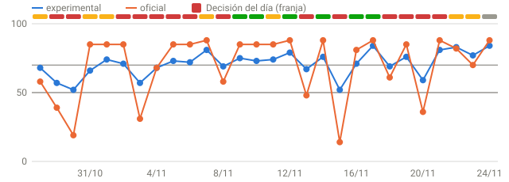
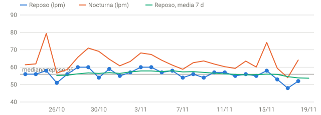
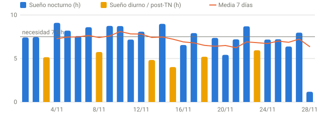

# Informe matutino · 17/11/2026

`GR-2026-11-17-1015-824b84` · cita este identificador al reenviar el informe.

> **Hoy: 🟢 verde — Listo para entrenar.** RPE ≤ 9 · volumen 100 %.
>
> **Por qué:** lo marcan Recuperación oficial (88) y Híbrido Garmin + local (93) y Modelo experimental (84); señales: Sueño 7,9 h, puntuación 95, deuda 4,4 h en 3 noches.
>
> **Qué hacer:** Entrena según lo planificado. Intensidad alta permitida si el calentamiento responde bien.

## 🟢 Decisión: verde — Listo para entrenar

| RPE máximo | Volumen | HRV | FC reposo | Sueño | Garmin Readiness |
|--:|--:|--:|--:|--:|--:|
| 9 | 100 % | 86 ms | 48 lpm | 7,92 h | 83/100 |

Cómo se decide (modelos)

| Modelo | Puntuación | Zona | Papel |
|---|--:|---|---|
| Recuperación oficial | 88 | verde | oficial |
| Híbrido Garmin + local | 93 | verde | salvaguarda |
| Modelo experimental | 84 | verde | sombra |
| Modelo de compatibilidad | 100 | verde | compatibilidad |
| Garmin Training Readiness | 83 | — | contexto |

_Las puntuaciones no son equivalentes entre sí. Zona operativa = la más conservadora entre el modelo oficial, el híbrido y el experimental. Un rojo prevalece siempre; si no hay rojo y algún modelo está pendiente, sin datos o es de otro día, queda pendiente. Un rojo de otro día sigue limitando hasta que llegue el dato de hoy._

## En el box hoy

- Sesión planificada completa: halterofilia pesada, fuerza y WOD a intensidad alta si el calentamiento responde.
- Calentamiento progresivo; si la barra va lenta en las aproximaciones, baja a la pauta ámbar.

## Cómo ajustar tu sesión de hoy

Reglas por tipo de sesión

Aplica la regla del tipo de sesión que decidas hacer (sobre tu prescripción habitual):

| Tipo | Ajuste de hoy | RPE máx. |
|---|---|--:|
| Fuerza | **Mantener:** Según lo planificado. | 9 |
| Halterofilia | **Mantener:** Según lo planificado. | 9 |
| WOD | **Mantener:** Según lo planificado. | 9 |
| Técnica | **Mantener:** Según lo planificado. | 9 |
| Aeróbico | **Mantener:** Según lo planificado. | 9 |
| Movilidad | **Mantener:** Según lo planificado. | 9 |

_Ejemplo en ámbar: sentadilla 5 × 3 a 150–160 kg → 4 × 3 a 135–142,5 kg. Para ajustar una sesión concreta, pregunta con este informe._

## Qué ha cambiado desde el informe anterior

Frente al informe GR-2026-11-17-0940-b776a3 (17/11 09:40):
- **Decisión:** pendiente → **verde**.
- Híbrido: 74 → 93 (+19).
- Nueva noche registrada: HRV — → 86 ms, sueño — → 7,92 h, FC reposo 48 → 48 lpm.

## Qué ha cambiado respecto a tu línea base

- **HRV:** 86 ms esta noche (+62 % vs. base 53 ms); media de 7 días 57,1 ms, dentro de tu rango normal (48–59 ms).
- **FC:** reposo 48 lpm (-8 vs. mediana 56); nocturna 54,0 lpm (-8,5).
- **Sueño:** 7,92 h, puntuación 95; deuda 4,4 h en 3 noches frente a 7,5 h de necesidad.
- **Estrés Garmin ayer:** 22 de media (tu mediana 34).

**Señales coincidentes:** 0 de 5 señales en contra; a favor: Variabilidad cardiaca (HRV), FC en reposo y nocturna, Estrés del día anterior (Garmin), Carga de entrenamiento. Sin datos: Sensaciones (Intervals).

## Incertidumbre

- Confianza de los datos: **alta**
- Confianza de la recomendación: **media** (modelo experimental aún sin validar frente a tu rendimiento real (modo sombra))

## Plan del día

- Entrena según lo planificado. Intensidad alta permitida si el calentamiento responde bien. RPE ≤ 9, volumen 100 %.
- Hoy turno de noche: si entrenas, que sea antes del turno, corto y sin máximos.

## Tendencias

## Recuperación: tendencias de 28 días

HRV, FC y sueño

## Acciones pendientes

- Registra en Intervals.icu fatiga, agujetas, estrés, ánimo y motivación (1 = mejor, 4 = peor).

## Fuerza (últimos 28 días)

Tabla y progresión

| Fecha | Ejercicio | Implemento | Carga máx. | Mejor serie | 1RM mín. | Volumen verificado | Series | RPE sesión |
|---|---|---|---|--:|--:|--:|--:|--:|
| 14/11 | peso muerto | barra | 180,0 kg con barra | 180 × 3 | 198,0 kg | 8.800 kg | 10/10 | 6,0 |
| 14/11 | peso muerto piernas semirrígidas con mancuernas | mancuernas (par) | 100,0 kg total (2 × 50,0 kg) | — | — | 3.984 kg | 4/4 | 6,0 |
| 14/11 | jalón al pecho en polea agarre ancho | máquina de placas | 80,0 kg indicados en máquina | — | — | 2.520 kg | 4/4 | 6,0 |
| 14/11 | curl femoral tumbado | máquina de placas | 67,0 kg indicados en máquina | — | — | 2.208 kg | 4/4 | 6,0 |
| 13/11 | chin up lastrado | sin especificar | 37,5 kg (unidad sin especificar) | — | — | 345 kg | 7/7 | 7,0 |
| 12/11 | DB split squat | mancuernas (par) | 60,0 kg total (2 × 30,0 kg) | 60 × 10 | 80,0 kg | 2.400 kg | 4/4 | — |
| 12/11 | feet elevated ring row | peso corporal | peso corporal | — | — | — | —/4 | — |
| 10/11 | press banca | barra | 100,0 kg con barra | 90 × 6 | 108,0 kg | 6.030 kg | 8/8 | 7,0 |
| 10/11 | press inclinado con mancuernas | mancuernas (par) | 67,0 kg total (2 × 33,5 kg) | 67 × 8 | 84,9 kg | 2.104 kg | 4/4 | 7,0 |
| 10/11 | press superinclinado isolateral | máquina de discos | 50,0 kg total (dos lados) | — | — | 1.680 kg | 4/4 | 7,0 |
| 10/11 | aperturas de pecho en máquina sentado | máquina de placas | 50,0 kg indicados en máquina | — | — | 1.900 kg | 4/4 | 7,0 |
| 10/11 | curl bíceps máquina unilateral | máquina de placas | 15,0 kg indicados en máquina | — | — | 540 kg | 4/4 | 7,0 |

_1RM mín. = Epley con tu mejor serie (kg × repeticiones, hasta 10). Si la serie no fue al fallo, tu 1RM real es igual o mayor: es un mínimo, no un máximo. No usa el RPE de la sesión._
_Volumen = kg × repeticiones de las series con carga conocida. No se comparan implementos distintos (barra, mancuernas, máquinas); las máquinas no son comparables con peso libre; el RPE es de la sesión, no de cada serie._

## Certificado

- **Identificador del informe:** `GR-2026-11-17-1015-824b84`

Detalle del certificado

- **Ciclo:** 2026-11-17-0830-post-sleep · datos sincronizados a las 10:14
- **Antigüedad:** fin del sueño hace 56 min ✓ · última HRV hace 60 min ✓ · última FC hace 28 min ✓ · último Body Battery hace 73 min ✓
- **Integridad:** coherencia experimental/oficial ✓ · sesiones con RPE 12/12 (+5 sin RPE por diseño: calentamiento/técnica)
- **Ejecución:** 0 franja(s) de Sync perdidas
- **Estado:** sin avisos · fuentes con huella SHA-256: 17 · entrega: no verificable desde los datos

_Herramienta de entrenamiento basada en tendencias personales; no es un diagnóstico médico. Generado 2026-11-17 10:15 · app 6.1.0 · modelo readiness-v3.2. Fuente única: `app/readiness_v3.json`._
