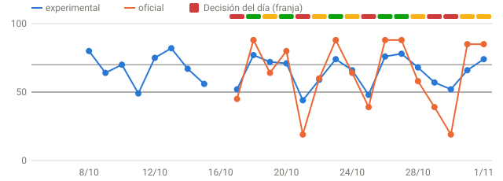
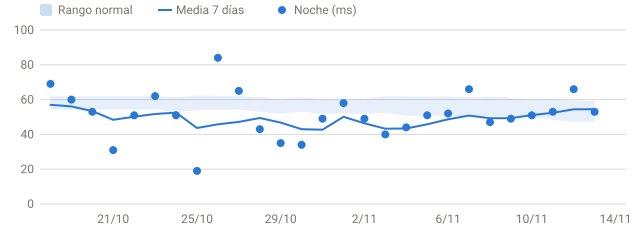
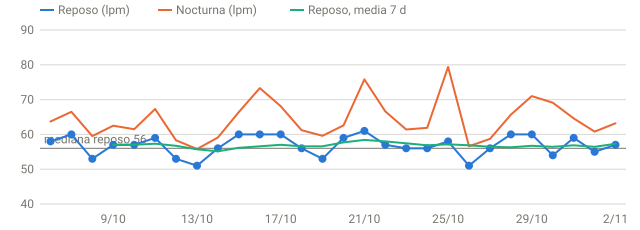
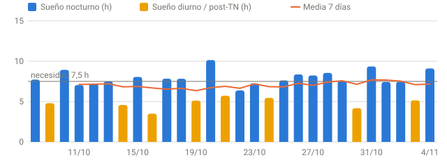

# Informe matutino · 01/11/2026

`GR-2026-11-01-0833-3dd272` · cita este identificador al reenviar el informe.

> **Hoy: 🟠 ámbar — Entrenar con control.** RPE ≤ 7 · volumen 70–80 %.
>
> **Por qué:** lo marca Híbrido Garmin + local (60); señales: Sueño 7,4 h, puntuación 81, deuda 3,4 h en 3 noches · HRV 58 ms hoy; media 7 días −10 % vs. tu base (por debajo de tu rango normal).
>
> **Qué hacer:** Mantén técnica y fuerza submáxima; reduce volumen un 20–30 % y evita series al fallo y WOD máximos.

## 🟠 Decisión: ámbar — Entrenar con control

| RPE máximo | Volumen | HRV | FC reposo | Sueño | Garmin Readiness |
|--:|--:|--:|--:|--:|--:|
| 7 | 70–80 % | 58 ms | 55 lpm | 7,42 h | 1/100 |

Cómo se decide (modelos)

| Modelo | Puntuación | Zona | Papel |
|---|--:|---|---|
| Recuperación oficial | 85 | verde | oficial |
| Híbrido Garmin + local | 60 | ámbar | salvaguarda |
| Modelo experimental | 74 | verde | sombra |
| Modelo de compatibilidad | 100 | verde | compatibilidad |
| Garmin Training Readiness | 1 | — | contexto |

_Las puntuaciones no son equivalentes entre sí. Zona operativa = la más conservadora entre el modelo oficial, el híbrido y el experimental. Un rojo prevalece siempre; si no hay rojo y algún modelo está pendiente, sin datos o es de otro día, queda pendiente. Un rojo de otro día sigue limitando hasta que llegue el dato de hoy._

## En el box hoy

- Halterofilia técnica al ≤ 80 % de tus cargas habituales, sin singles pesados.
- Fuerza submáxima: deja 2–3 repeticiones en reserva, sin series al fallo.
- WOD a ritmo controlado (sin all-out ni lucha contra el cap); recorta un 20–30 % de volumen.

## Cómo ajustar tu sesión de hoy

Reglas por tipo de sesión

Aplica la regla del tipo de sesión que decidas hacer (sobre tu prescripción habitual):

| Tipo | Ajuste de hoy | RPE máx. |
|---|---|--:|
| Fuerza | **Reducir:** −25 % de series; cargas al 90 % de lo habitual; 2–3 repeticiones en reserva, sin fallo. | 7 |
| Halterofilia | **Reducir:** −25 % de series; cargas al 80 % de lo habitual; técnica, sin singles pesados. | 7 |
| WOD | **Reducir:** −20–30 % de volumen o tiempo; ritmo controlado, sin all-out; escala cargas un 10–20 %. | 7 |
| Técnica | **Reducir:** según lo planificado, sin buscar intensidad. | 7 |
| Aeróbico | **Reducir:** según lo planificado, sin buscar intensidad. | 7 |
| Movilidad | **Reducir:** según lo planificado, sin buscar intensidad. | 7 |

_Ejemplo en ámbar: sentadilla 5 × 3 a 150–160 kg → 4 × 3 a 135–142,5 kg. Para ajustar una sesión concreta, pregunta con este informe._

## Qué ha cambiado desde el informe anterior

Frente al informe GR-2026-10-31-2248-ded867 (31/10 22:48):
- Híbrido: 51 → 60 (+9).
- v3: 66 → 74 (+8).
- Nueva noche registrada: HRV 49 → 58 ms, sueño 9,35 → 7,42 h, FC reposo 59 → 55 lpm.
- Sesiones con RPE: 16 → 15.

## Qué ha cambiado respecto a tu línea base

- **HRV:** 58 ms esta noche (+4 % vs. base 56 ms); media de 7 días 50,1 ms, por debajo de tu rango normal (52–60 ms).
- **FC:** reposo 55 lpm (-1 vs. mediana 56); nocturna 60,8 lpm (-1,7).
- **Sueño:** 7,42 h, puntuación 81; deuda 3,4 h en 3 noches frente a 7,5 h de necesidad.
- **Estrés Garmin ayer:** 34 de media (tu mediana 38).

**Señales coincidentes:** 0 de 4 señales en contra. Sin datos: Carga de entrenamiento, Sensaciones (Intervals).

## Incertidumbre

- Confianza de los datos: **alta**
- Confianza de la recomendación: **media** (modelo experimental aún sin validar frente a tu rendimiento real (modo sombra))
- El modelo experimental (verde) es más permisivo que la decisión (ámbar); se aplica la más conservadora.

## Plan del día

- Mantén técnica y fuerza submáxima; reduce volumen un 20–30 % y evita series al fallo y WOD máximos. RPE ≤ 7, volumen 70–80 %.
- Turno de hoy: MT.

## Tendencias

## Recuperación: tendencias de 28 días

HRV, FC y sueño

## Acciones pendientes

- Registra en Intervals.icu fatiga, agujetas, estrés, ánimo y motivación (1 = mejor, 4 = peor).

## Fuerza (últimos 28 días)

Tabla y progresión

| Fecha | Ejercicio | Implemento | Carga máx. | Mejor serie | 1RM mín. | Volumen verificado | Series | RPE sesión |
|---|---|---|---|--:|--:|--:|--:|--:|
| 30/10 | chin up lastrado | sin especificar | 15,0 kg (unidad sin especificar) | — | — | 220 kg | 5/5 | — |
| 30/10 | isometric pull up | sin especificar | — | — | — | — (parcial) | —/5 | — |
| 28/10 | squat clean | barra | 100,0 kg con barra | 100 × 1 | 100,0 kg | 1.178 kg | 13/13 | 7,5 |
| 28/10 | front squat | barra | 70,0 kg con barra | 70 × 1 | 70,0 kg | 413 kg | 7/7 | 7,5 |
| 28/10 | split jerk | barra | 100,0 kg con barra | 100 × 1 | 100,0 kg | 938 kg | 13/13 | 7,5 |
| 27/10 | DB split squat | mancuernas (par) | 60,0 kg total (2 × 30,0 kg) | — | — | 2.160 kg | 3/3 | — |
| 27/10 | ring row feet elevated | peso corporal | peso corporal | — | — | — | —/3 | — |
| 26/10 | press banca | barra | 90,0 kg con barra | 90 × 6 | 108,0 kg | 4.620 kg | 7/7 | 7,0 |
| 26/10 | press banca inclinado con mancuernas | mancuernas (par) | 67,0 kg total (2 × 33,5 kg) | 67 × 7 | 82,6 kg | 1.930 kg | 4/4 | 7,0 |
| 26/10 | press superinclinado isolateral | máquina de discos | 50,0 kg total (dos lados) | — | — | 1.600 kg | 4/4 | 7,0 |
| 26/10 | aperturas en banco inclinado con mancuernas | mancuernas (par) | 32,0 kg total (2 × 16,0 kg) | 32 × 10 | 42,7 kg | 1.088 kg | 4/4 | 7,0 |
| 26/10 | curl de bíceps en máquina unilateral | máquina de placas | 15,0 kg indicados en máquina | — | — | 440 kg | 4/4 | 7,0 |

_1RM mín. = Epley con tu mejor serie (kg × repeticiones, hasta 10). Si la serie no fue al fallo, tu 1RM real es igual o mayor: es un mínimo, no un máximo. No usa el RPE de la sesión._
_Volumen = kg × repeticiones de las series con carga conocida. No se comparan implementos distintos (barra, mancuernas, máquinas); las máquinas no son comparables con peso libre; el RPE es de la sesión, no de cada serie._

## Certificado

- **Identificador del informe:** `GR-2026-11-01-0833-3dd272`

Detalle del certificado

- **Ciclo:** 2026-11-01-0830 · datos sincronizados a las 08:32
- **Antigüedad:** fin del sueño hace 58 min ✓ · última HRV hace 63 min ✓ · última FC hace 31 min ✓ · último Body Battery hace 57 min ✓
- **Integridad:** coherencia experimental/oficial ✓ · sesiones con RPE 15/15 (+9 sin RPE por diseño: calentamiento/técnica)
- **Ejecución:** 0 franja(s) de Sync perdidas
- **Estado:** sin avisos · fuentes con huella SHA-256: 17 · entrega: no verificable desde los datos

_Herramienta de entrenamiento basada en tendencias personales; no es un diagnóstico médico. Generado 2026-11-01 08:33 · app 6.1.0 · modelo readiness-v3.2. Fuente única: `app/readiness_v3.json`._
