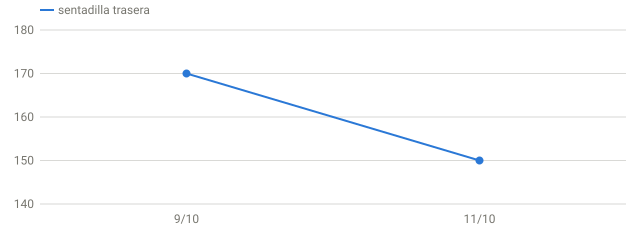

# Informe matutino · 18/10/2026

`GR-2026-10-18-0038-aff960` · cita este identificador al reenviar el informe.

> ⚠️ Certificado con avisos: 2 franja(s) de Sync sin ejecutar ni recuperar.

> **Hoy: ⚪ pendiente — Pendiente de datos.** RPE ≤ 6 · volumen según sensaciones.
>
> **Por qué:** faltan datos de hoy (hrv_ms, sleep_hours, resting_hr).
>
> **Qué hacer:** Faltan datos de hoy: no se autoriza intensidad alta. Reevaluar tras sincronizar el sueño.

## ⚪ Decisión: pendiente — Pendiente de datos

| RPE máximo | Volumen | HRV | FC reposo | Sueño | Garmin Readiness |
|--:|--:|--:|--:|--:|--:|
| 6 | según sensaciones | — ms | — lpm | — h | —/100 |

Cómo se decide (modelos)

| Modelo | Puntuación | Zona | Papel |
|---|--:|---|---|
| Recuperación v2 (oficial) | — | pendiente | oficial |
| Híbrido Garmin + local | 74 | ámbar | salvaguarda |
| Disponibilidad v3 (en pruebas) | — | pendiente | sombra |
| Modelo de compatibilidad | 74 | ámbar | compatibilidad |
| Garmin Training Readiness | — | — | contexto |

_Las puntuaciones no son equivalentes entre sí. Zona operativa = la más conservadora entre v2 (oficial), híbrido y v3. Un rojo prevalece siempre; si no hay rojo y algún modelo está pendiente, sin datos o es de otro día, queda pendiente. Un rojo de otro día sigue limitando hasta que llegue el dato de hoy._

## En el box hoy

- Hasta tener datos: solo técnica ligera y movilidad; nada de intensidad alta.

## Cómo ajustar tu sesión de hoy

Reglas por tipo de sesión

Aplica la regla del tipo de sesión que decidas hacer (sobre tu prescripción habitual):

| Tipo | Ajuste de hoy | RPE máx. |
|---|---|--:|
| Fuerza | **Sustituir:** Técnica del patrón con barra vacía o PVC (15–20 min) + movilidad. Sin cargas. | 6 |
| Halterofilia | **Sustituir:** Técnica con PVC o barra vacía (15–20 min): posiciones y recepciones. Sin cargas. | 6 |
| WOD | **Sustituir:** Zona 2 suave 30–40 min (remo, bici o caminata), pudiendo hablar. | 6 |
| Técnica | **Reducir:** Técnica ligera ≤ 15 min, sin fatiga. Revisa de nuevo cuando se confirme el sueño. | 6 |
| Aeróbico | **Reducir:** Zona 2 suave ≤ 40 min. Revisa de nuevo cuando se confirme el sueño. | 6 |
| Movilidad | **Mantener:** Movilidad tal como está planificada. Revisa de nuevo cuando se confirme el sueño. | 6 |

_Ejemplo en ámbar: sentadilla 5 × 3 a 150–160 kg → 4 × 3 a 135–142,5 kg. Para ajustar una sesión concreta, pregunta con este informe._

## Qué ha cambiado desde el informe anterior

Frente al informe GR-2026-10-18-0033-ac7f11 (18/10 00:33):
- Sin cambios en los datos.

## Qué ha cambiado respecto a tu línea base

- **Estrés Garmin ayer:** 38 de media (tu mediana 39).

**Señales coincidentes:** 0 de 1 señales en contra. Sin datos: Variabilidad cardiaca (HRV), FC en reposo y nocturna, Sueño, Carga de entrenamiento, Sensaciones (Intervals).

## Incertidumbre

- Confianza de los datos: **baja** (faltan datos de hoy: hrv_ms, sleep_hours, resting_hr; sueño de hoy sin confirmar; cobertura 7 días: 5/7 noches en la métrica más incompleta)
- Confianza de la recomendación: **baja** (sin evaluación completa hoy)

## Plan del día

- Faltan datos de hoy: no se autoriza intensidad alta. Reevaluar tras sincronizar el sueño. RPE ≤ 6, volumen según sensaciones.
- Hoy turno de noche: si entrenas, que sea antes del turno, corto y sin máximos.

## Tendencias

## Recuperación: tendencias de 28 días

HRV, FC y sueño

## Acciones pendientes

- Registra en Intervals.icu fatiga, agujetas, estrés, ánimo y motivación (1 = mejor, 4 = peor).

## Fuerza (últimos 28 días)

Tabla y progresión

| Fecha | Ejercicio | Implemento | Carga máx. | Mejor serie | 1RM mín. | Volumen verificado | Series | RPE sesión |
|---|---|---|---|--:|--:|--:|--:|--:|
| 13/10 | Fuerza - Squat snatch EMOM 8 min | barra | 68,0 kg con barra | 68 × 1 | 68,0 kg | 578 kg | 8/8 | 6,0 |
| 11/10 | sentadilla trasera | barra | 150,0 kg con barra | 120 × 8 | 152,0 kg | 4.260 kg | 9/9 | 6,0 |
| 11/10 | prensa horizontal | máquina de placas | 120,0 kg indicados en máquina | — | — | 4.320 kg | 4/4 | 6,0 |
| 11/10 | curl femoral tumbado | máquina de placas | 60,0 kg indicados en máquina | — | — | 2.712 kg | 4/4 | 6,0 |
| 11/10 | curl femoral de pie unilateral | máquina de placas | 40,0 kg indicados en máquina | — | — | 2.560 kg | 8/8 | 6,0 |
| 10/10 | press de pecho inclinado con mancuernas | mancuernas (par) | 80,0 kg total (2 × 40,0 kg) | 80 × 4 | 90,7 kg | 3.488 kg | 7/7 | 6,0 |
| 10/10 | press banca en máquina sentado | máquina de placas | 65,0 kg indicados en máquina | — | — | 2.080 kg | 4/4 | 6,0 |
| 10/10 | press superinclinado iso lateral | máquina de discos | 60,0 kg total (dos lados) | — | — | 2.400 kg | 5/5 | 6,0 |
| 10/10 | aperturas de pecho en máquina sentado | máquina de placas | 50,5 kg indicados en máquina | — | — | 2.020 kg | 4/4 | 6,0 |
| 10/10 | tríceps en polea | máquina de placas | 60,0 kg indicados en máquina | — | — | 2.880 kg | 4/4 | 6,0 |
| 10/10 | fondos de pecho | peso corporal | peso corporal | — | — | — | —/4 | 6,0 |
| 10/10 | sit-ups | peso corporal | peso corporal | — | — | — | —/4 | 6,0 |

_1RM mín. = Epley con tu mejor serie (kg × repeticiones, hasta 10). Si la serie no fue al fallo, tu 1RM real es igual o mayor: es un mínimo, no un máximo. No usa el RPE de la sesión._
_Volumen = kg × repeticiones de las series con carga conocida. No se comparan implementos distintos (barra, mancuernas, máquinas); las máquinas no son comparables con peso libre; el RPE es de la sesión, no de cada serie._

_Por ejercicio con barra: 1RM mínimo estimado (Epley con la mejor serie) cuando hay repeticiones; si no, carga máxima declarada. Una sesión de volumen da un mínimo más bajo que una de series pesadas cortas._

## Certificado

- **Identificador del informe:** `GR-2026-10-18-0038-aff960`

Detalle del certificado

- **Ciclo:** 2026-10-17-2245 · datos sincronizados a las 00:37 · Sync fuera de franja
- **Antigüedad:** fin del sueño hace 17,1 h ✓ · última HRV hace 17,1 h ✓ · última FC hace 2,4 h ✓ · último Body Battery hace 24 min ✓
- **Integridad:** coherencia v3/v2 ✓ · sesiones con RPE 17/17
- **Ejecución:** 2 franja(s) de Sync perdidas (17/10 08:30, 17/10 16:45)
- **Estado:** con avisos · fuentes con huella SHA-256: 17 · entrega: no verificable desde los datos

_Herramienta de entrenamiento basada en tendencias personales; no es un diagnóstico médico. Generado 2026-10-18 00:38 · app 6.1.0 · modelo readiness-v3.2. Fuente única: `app/readiness_v3.json`._
