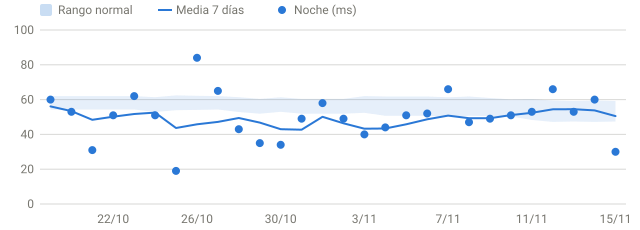

# Cierre diario · 18/11/2026

`GR-2026-11-18-2152-29fb27` · cita este identificador al reenviar el informe.

> **Hoy: 🔴 rojo — Prioriza recuperar.** RPE ≤ 4 · volumen 0–50 %.
>
> **Por qué:** lo marca Híbrido Garmin + local (31); señales: Sueño 5,2 h, puntuación 53, deuda 3,2 h en 3 noches · HRV 48 ms hoy; media 7 días +6 % vs. tu base (dentro de tu rango normal).
>
> **Qué hacer:** Movilidad, zona 2 suave (30–40 min) o descanso. Sin cargas máximas ni WOD intensos.

## 🔴 Decisión: rojo — Prioriza recuperar

| RPE máximo | Volumen | HRV | FC reposo | Sueño | Garmin Readiness |
|--:|--:|--:|--:|--:|--:|
| 4 | 0–50 % | 48 ms | 52 lpm | 5,20 h | 32/100 |

Cómo se decide (modelos)

| Modelo | Puntuación | Zona | Papel |
|---|--:|---|---|
| Recuperación oficial | 61 | ámbar | oficial |
| Híbrido Garmin + local | 31 | rojo | salvaguarda |
| Modelo experimental | 70 | verde | sombra |
| Modelo de compatibilidad | 31 | rojo | compatibilidad |
| Garmin Training Readiness | 32 | — | contexto |

_Las puntuaciones no son equivalentes entre sí. Zona operativa = la más conservadora entre el modelo oficial, el híbrido y el experimental. Un rojo prevalece siempre; si no hay rojo y algún modelo está pendiente, sin datos o es de otro día, queda pendiente. Un rojo de otro día sigue limitando hasta que llegue el dato de hoy._

## En el box hoy

- Sin WOD ni cargas pesadas: movilidad, técnica con PVC o barra vacía.
- Si te mueves, zona 2 suave en remo, bici o caminata (30–40 min, poder hablar).

## Cómo ajustar tu sesión de hoy

Reglas por tipo de sesión

Aplica la regla del tipo de sesión que decidas hacer (sobre tu prescripción habitual):

| Tipo | Ajuste de hoy | RPE máx. |
|---|---|--:|
| Fuerza | **Sustituir:** Técnica del patrón con barra vacía o PVC (15–20 min) + movilidad. Sin cargas. | 4 |
| Halterofilia | **Sustituir:** Técnica con PVC o barra vacía (15–20 min): posiciones y recepciones. Sin cargas. | 4 |
| WOD | **Sustituir:** Zona 2 suave 30–40 min (remo, bici o caminata), pudiendo hablar. | 4 |
| Técnica | **Reducir:** Técnica ligera ≤ 15 min, sin fatiga. | 4 |
| Aeróbico | **Reducir:** Zona 2 suave ≤ 40 min. | 4 |
| Movilidad | **Mantener:** Movilidad tal como está planificada. | 4 |

_Ejemplo en ámbar: sentadilla 5 × 3 a 150–160 kg → 4 × 3 a 135–142,5 kg. Para ajustar una sesión concreta, pregunta con este informe._

## Qué ha cambiado desde el informe anterior

Frente al informe GR-2026-11-18-1650-8ff0ca (18/11 16:50):
- Híbrido: 35 → 31 (-4).
- Sesiones nuevas desde entonces: **3** (carga +46).

## Balance del día

| Fecha | Tipo | Sesión | Min | Carga | FC media / máx. | RPE | sRPE |
|---|---|---|--:|--:|--:|--:|--:|
| 18/11 19:57 | Sin detalle | HIIT | 24 | 24 | 147 / 193 | — | — |
| 18/11 19:37 | Sin detalle | HIIT | 15 | 5 | 105 / 149 | — | — |
| 18/11 18:17 | Sin detalle | HIIT | 48 | 17 | 108 / 157 | — | — |

## Balance de la semana

- Carga 7 días: **155** en 10 sesiones (0 % vs. semana previa).
- sRPE 7 días 820 · monotonía — · strain —.
- Fatiga acumulada: ATL 25,6, CTL 13,3, TSB -12,3 (CTL insuficiente: la forma no se interpreta todavía).

## Previsión orientativa para mañana

- Objetivo de sueño esta noche: **8,5 h** (necesidad + parte de la deuda de 3,2 h).
- La decisión de mañana dependerá del sueño y la HRV de esta noche; no se anticipa.

## Gráficas

_Barras: RPE de la sesión más dura de cada día, por tipo. Raya gris: máximo que permitía la decisión de ese día (verde 9, ámbar 7, rojo 4, pendiente 6); en días verdes un WOD a RPE 8–9 está dentro. Punto rojo: por encima del máximo. Franja superior: decisión del día._

## Validación de modelos

_¿La puntuación de la mañana anticipa cuánto te cuesta entrenar? Se compara con tu esfuerzo relativo (RPE × duración frente a la carga cardiaca, dentro de cada tipo de sesión). Un modelo útil tiene correlación negativa: puntuación baja → el mismo trabajo te cuesta más._

**Acumulando datos: 16/20 días con entrenamiento, RPE y predicción de la mañana del v2 y del v3. Aún no hay veredicto.**

| Modelo | ρ esfuerzo | IC 90 % | Días |
|---|--:|---|--:|
| Oficial v2 | -0,19 | -0,58 a 0,26 | 16 |
| Híbrido | -0,36 | -0,69 a 0,09 | 16 |
| v3 (en pruebas) | -0,24 | -0,61 a 0,22 | 16 |
| Decisión operativa | -0,32 | -0,66 a 0,13 | 16 |

- Días entrenados con predicción: 17; por encima del RPE máximo del día: 8.

## Recuperación: tendencias de 28 días

HRV, FC y sueño

## Acciones pendientes

- Añade el RPE de la actividad **i211772102** (18/11 18:17, Sin detalle, 48 min, carga 17) en la pestaña `RPE` de tu hoja, con ese ID exacto. Si fue un calentamiento registrado aparte, anótalo así. No se estima.
- Añade el RPE de la actividad **i211789156** (18/11 19:37, Sin detalle, 15 min, carga 5) en la pestaña `RPE` de tu hoja, con ese ID exacto. Si fue un calentamiento registrado aparte, anótalo así. No se estima.
- Añade el RPE de la actividad **i211802592** (18/11 19:57, Sin detalle, 24 min, carga 24) en la pestaña `RPE` de tu hoja, con ese ID exacto. Si fue un calentamiento registrado aparte, anótalo así. No se estima.
- Registra en Intervals.icu fatiga, agujetas, estrés, ánimo y motivación (1 = mejor, 4 = peor).

## Fuerza (últimos 28 días)

Tabla y progresión

| Fecha | Ejercicio | Implemento | Carga máx. | Mejor serie | 1RM mín. | Volumen verificado | Series | RPE sesión |
|---|---|---|---|--:|--:|--:|--:|--:|
| 14/11 | peso muerto | barra | 180,0 kg con barra | 180 × 3 | 198,0 kg | 8.800 kg | 10/10 | 6,0 |
| 14/11 | peso muerto piernas semirrígidas con mancuernas | mancuernas (par) | 100,0 kg total (2 × 50,0 kg) | — | — | 3.984 kg | 4/4 | 6,0 |
| 14/11 | jalón al pecho en polea agarre ancho | máquina de placas | 80,0 kg indicados en máquina | — | — | 2.520 kg | 4/4 | 6,0 |
| 14/11 | curl femoral tumbado | máquina de placas | 67,0 kg indicados en máquina | — | — | 2.208 kg | 4/4 | 6,0 |
| 13/11 | chin up lastrado | sin especificar | 37,5 kg (unidad sin especificar) | — | — | 345 kg | 7/7 | 7,0 |
| 12/11 | DB split squat | mancuernas (par) | 60,0 kg total (2 × 30,0 kg) | 60 × 10 | 80,0 kg | 2.400 kg | 4/4 | — |
| 12/11 | feet elevated ring row | peso corporal | peso corporal | — | — | — | —/4 | — |
| 10/11 | press banca | barra | 100,0 kg con barra | 90 × 6 | 108,0 kg | 6.030 kg | 8/8 | 7,0 |
| 10/11 | press inclinado con mancuernas | mancuernas (par) | 67,0 kg total (2 × 33,5 kg) | 67 × 8 | 84,9 kg | 2.104 kg | 4/4 | 7,0 |
| 10/11 | press superinclinado isolateral | máquina de discos | 50,0 kg total (dos lados) | — | — | 1.680 kg | 4/4 | 7,0 |
| 10/11 | aperturas de pecho en máquina sentado | máquina de placas | 50,0 kg indicados en máquina | — | — | 1.900 kg | 4/4 | 7,0 |
| 10/11 | curl bíceps máquina unilateral | máquina de placas | 15,0 kg indicados en máquina | — | — | 540 kg | 4/4 | 7,0 |

_1RM mín. = Epley con tu mejor serie (kg × repeticiones, hasta 10). Si la serie no fue al fallo, tu 1RM real es igual o mayor: es un mínimo, no un máximo. No usa el RPE de la sesión._
_Volumen = kg × repeticiones de las series con carga conocida. No se comparan implementos distintos (barra, mancuernas, máquinas); las máquinas no son comparables con peso libre; el RPE es de la sesión, no de cada serie._

## Certificado

- **Identificador del informe:** `GR-2026-11-18-2152-29fb27`

Detalle del certificado

- **Ciclo:** 2026-11-18-1645 · datos sincronizados a las 21:51 · Sync fuera de franja
- **Antigüedad:** fin del sueño hace 8,6 h ✓ · última HRV hace 9,1 h ✓ · última FC hace 45 min ✓ · último Body Battery hace 68 min ✓
- **Integridad:** coherencia experimental/oficial ✓ · sesiones con RPE 11/14 (+4 sin RPE por diseño: calentamiento/técnica) (sin RPE: 18/11 18:17, 18/11 19:37, 18/11 19:57)
- **Ejecución:** 0 franja(s) de Sync perdidas
- **Estado:** sin avisos · fuentes con huella SHA-256: 17 · entrega: no verificable desde los datos

_Herramienta de entrenamiento basada en tendencias personales; no es un diagnóstico médico. Generado 2026-11-18 21:52 · app 6.1.0 · modelo readiness-v3.2. Fuente única: `app/readiness_v3.json`._
