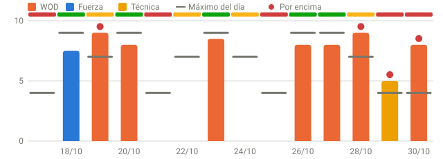
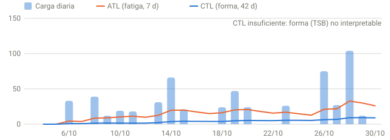
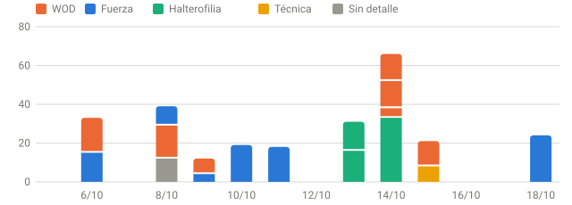
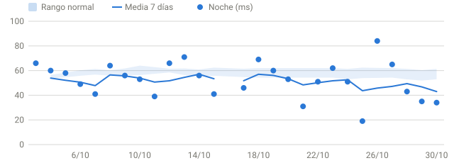
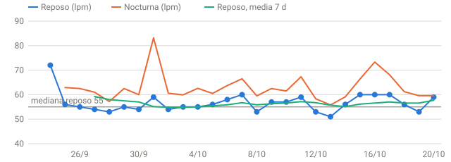
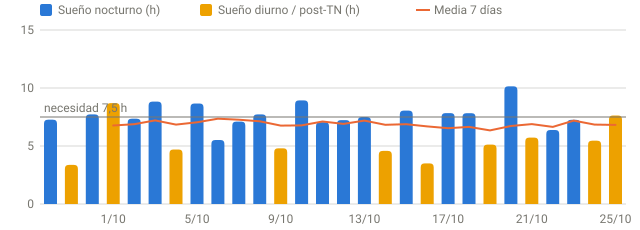

# Informe de seguimiento · 26/10/2026

`GR-2026-10-26-1527-5412fd` · cita este identificador al reenviar el informe.

> **Hoy: 🟢 verde — Listo para entrenar.** RPE ≤ 9 · volumen 100 %.
>
> **Por qué:** lo marcan Recuperación oficial (88) y Híbrido Garmin + local (76) y Modelo experimental (76); señales: Estrés Garmin ayer 56 de media (tu mediana 38).
>
> **Qué hacer:** Entrena según lo planificado. Intensidad alta permitida si el calentamiento responde bien.

## 🟢 Decisión: verde — Listo para entrenar

| RPE máximo | Volumen | HRV | FC reposo | Sueño | Garmin Readiness |
|--:|--:|--:|--:|--:|--:|
| 9 | 100 % | 84 ms | 51 lpm | 8,36 h | 39/100 |

Cómo se decide (modelos)

| Modelo | Puntuación | Zona | Papel |
|---|--:|---|---|
| Recuperación oficial | 88 | verde | oficial |
| Híbrido Garmin + local | 76 | verde | salvaguarda |
| Modelo experimental | 76 | verde | sombra |
| Modelo de compatibilidad | 100 | verde | compatibilidad |
| Garmin Training Readiness | 39 | — | contexto |

_Las puntuaciones no son equivalentes entre sí. Zona operativa = la más conservadora entre el modelo oficial, el híbrido y el experimental. Un rojo prevalece siempre; si no hay rojo y algún modelo está pendiente, sin datos o es de otro día, queda pendiente. Un rojo de otro día sigue limitando hasta que llegue el dato de hoy._

## En el box hoy

- Sesión planificada completa: halterofilia pesada, fuerza y WOD a intensidad alta si el calentamiento responde.
- Calentamiento progresivo; si la barra va lenta en las aproximaciones, baja a la pauta ámbar.

## Cómo ajustar tu sesión de hoy

Reglas por tipo de sesión

Aplica la regla del tipo de sesión que decidas hacer (sobre tu prescripción habitual):

| Tipo | Ajuste de hoy | RPE máx. |
|---|---|--:|
| Fuerza | **Mantener:** Según lo planificado. | 9 |
| Halterofilia | **Mantener:** Según lo planificado. | 9 |
| WOD | **Mantener:** Según lo planificado. | 9 |
| Técnica | **Mantener:** Según lo planificado. | 9 |
| Aeróbico | **Mantener:** Según lo planificado. | 9 |
| Movilidad | **Mantener:** Según lo planificado. | 9 |

_Ejemplo en ámbar: sentadilla 5 × 3 a 150–160 kg → 4 × 3 a 135–142,5 kg. Para ajustar una sesión concreta, pregunta con este informe._

## Qué ha cambiado desde el informe anterior

Frente al informe GR-2026-10-26-1351-549feb (26/10 13:51):
- Sin cambios en los datos.

## Actividad de hoy

| Fecha | Tipo | Sesión | Min | Carga | FC media / máx. | RPE | sRPE |
|---|---|---|--:|--:|--:|--:|--:|
| 26/10 10:26 | Sin detalle | HIIT | 47 | 21 | 119 / 160 | — | — |
| 26/10 09:59 | Halterofilia | WOD AMRAP 12 min - squat snatch / burpee over bar / toes to bar | 20 | 18 | 143 / 176 | 8,0 | 159 |
| 26/10 09:25 | Halterofilia | Fuerza - Squat snatch | 25 | 13 | 125 / 159 | 7,0 | 172 |

**¿Encaja con la decisión?** La actividad de hoy (carga 52, RPE máx. 8,0) encaja con la decisión.

**Carga 7 días:** 102 en 7 sesiones (-46 % vs. semana previa) · sRPE 531 · monotonía —.

## Gráficas

_Barras: RPE de la sesión más dura de cada día, por tipo. Raya gris: máximo que permitía la decisión de ese día (verde 9, ámbar 7, rojo 4, pendiente 6); en días verdes un WOD a RPE 8–9 está dentro. Punto rojo: por encima del máximo. Franja superior: decisión del día._

## Recuperación: tendencias de 28 días

HRV, FC y sueño

## Acciones pendientes

- Registra en Intervals.icu fatiga, agujetas, estrés, ánimo y motivación (1 = mejor, 4 = peor).

## Fuerza (últimos 28 días)

Tabla y progresión

| Fecha | Ejercicio | Implemento | Carga máx. | Mejor serie | 1RM mín. | Volumen verificado | Series | RPE sesión |
|---|---|---|---|--:|--:|--:|--:|--:|
| 26/10 | squat snatch | barra | 75,0 kg con barra | 75 × 1 | 75,0 kg | 1.119 kg | 9/9 | 7,0 |
| 23/10 | chin up lastrado | sin especificar | 15,0 kg (unidad sin especificar) | — | — | 225 kg | 4/4 | — |
| 23/10 | isometric pull up | sin especificar | — | — | — | — (parcial) | —/4 | — |
| 20/10 | DB split squat | mancuernas (par) | 45,0 kg total (2 × 22,5 kg) | 45 × 10 | 60,0 kg | 1.800 kg | 4/4 | — |
| 20/10 | ring row pies elevados | peso corporal | peso corporal | — | — | — | —/4 | — |
| 19/10 | power clean + squat clean (complex 1+1) | barra | 90,0 kg con barra | 90 × 1 | 90,0 kg | 515 kg | 5/5 | 8,0 |
| 19/10 | squat clean | barra | 110,0 kg con barra | 110 × 1 | 110,0 kg | 685 kg | 5/5 | 8,0 |
| 19/10 | power clean + squat clean (complex 1+1) | barra | 60,0 kg con barra | 60 × 1 | 60,0 kg | 150 kg | 3/3 | — |
| 18/10 | sentadilla trasera | barra | 185,0 kg con barra | 185 × 1 | 185,0 kg | 5.415 kg | 15/15 | 7,5 |
| 18/10 | sentadilla péndulo | máquina de placas | 60,0 kg indicados en máquina | — | — | 1.920 kg | 4/4 | 7,5 |
| 18/10 | curl femoral tumbado | máquina de placas | 67,0 kg indicados en máquina | — | — | 2.208 kg | 4/4 | 7,5 |
| 18/10 | curl femoral de pie unilateral | máquina de placas | 42,5 kg indicados en máquina | — | — | 3.400 kg | 8/8 | 7,5 |

_1RM mín. = Epley con tu mejor serie (kg × repeticiones, hasta 10). Si la serie no fue al fallo, tu 1RM real es igual o mayor: es un mínimo, no un máximo. No usa el RPE de la sesión._
_Volumen = kg × repeticiones de las series con carga conocida. No se comparan implementos distintos (barra, mancuernas, máquinas); las máquinas no son comparables con peso libre; el RPE es de la sesión, no de cada serie._

## Certificado

- **Identificador del informe:** `GR-2026-10-26-1527-5412fd`

Detalle del certificado

- **Ciclo:** 2026-10-26-0830-post-sleep · datos sincronizados a las 15:26 · Sync fuera de franja
- **Antigüedad:** fin del sueño hace 6,8 h ✓ · última HRV hace 6,8 h ✓ · última FC hace 28 min ✓ · último Body Battery hace 31 min ✓
- **Integridad:** coherencia experimental/oficial ✓ · sesiones con RPE 15/15 (+5 sin RPE por diseño: calentamiento/técnica)
- **Ejecución:** 0 franja(s) de Sync perdidas
- **Estado:** sin avisos · fuentes con huella SHA-256: 17 · entrega: no verificable desde los datos

_Herramienta de entrenamiento basada en tendencias personales; no es un diagnóstico médico. Generado 2026-10-26 15:27 · app 6.1.0 · modelo readiness-v3.2. Fuente única: `app/readiness_v3.json`._
