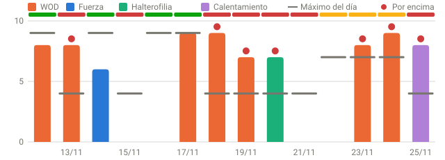

# Informe de seguimiento · 28/11/2026

`GR-2026-11-28-1352-09d72f` · cita este identificador al reenviar el informe.

> **Hoy: 🔴 rojo — Prioriza recuperar.** RPE ≤ 4 · volumen 0–50 %.
>
> **Por qué:** lo marca Híbrido Garmin + local (15); señales: Sueño 2,6 h, puntuación 22, deuda 6,0 h en 3 noches · ACWR 1.26.
>
> **Qué hacer:** Movilidad, zona 2 suave (30–40 min) o descanso. Sin cargas máximas ni WOD intensos.

## 🔴 Decisión: rojo — Prioriza recuperar

| RPE máximo | Volumen | HRV | FC reposo | Sueño | Garmin Readiness |
|--:|--:|--:|--:|--:|--:|
| 4 | 0–50 % | 51 ms | 55 lpm | 2,57 h | 3/100 |

Cómo se decide (modelos)

| Modelo | Puntuación | Zona | Papel |
|---|--:|---|---|
| Recuperación oficial | — | pendiente | oficial |
| Híbrido Garmin + local | 15 | rojo | salvaguarda |
| Modelo experimental | 63 | ámbar | sombra |
| Modelo de compatibilidad | 23 | rojo | compatibilidad |
| Garmin Training Readiness | 3 | — | contexto |

_Las puntuaciones no son equivalentes entre sí. Zona operativa = la más conservadora entre el modelo oficial, el híbrido y el experimental. Un rojo prevalece siempre; si no hay rojo y algún modelo está pendiente, sin datos o es de otro día, queda pendiente. Un rojo de otro día sigue limitando hasta que llegue el dato de hoy._

## En el box hoy

- Sin WOD ni cargas pesadas: movilidad, técnica con PVC o barra vacía.
- Si te mueves, zona 2 suave en remo, bici o caminata (30–40 min, poder hablar).

## Cómo ajustar tu sesión de hoy

Reglas por tipo de sesión

Aplica la regla del tipo de sesión que decidas hacer (sobre tu prescripción habitual):

| Tipo | Ajuste de hoy | RPE máx. |
|---|---|--:|
| Fuerza | **Sustituir:** Técnica del patrón con barra vacía o PVC (15–20 min) + movilidad. Sin cargas. | 4 |
| Halterofilia | **Sustituir:** Técnica con PVC o barra vacía (15–20 min): posiciones y recepciones. Sin cargas. | 4 |
| WOD | **Sustituir:** Zona 2 suave 30–40 min (remo, bici o caminata), pudiendo hablar. | 4 |
| Técnica | **Reducir:** Técnica ligera ≤ 15 min, sin fatiga. | 4 |
| Aeróbico | **Reducir:** Zona 2 suave ≤ 40 min. | 4 |
| Movilidad | **Mantener:** Movilidad tal como está planificada. | 4 |

_Ejemplo en ámbar: sentadilla 5 × 3 a 150–160 kg → 4 × 3 a 135–142,5 kg. Para ajustar una sesión concreta, pregunta con este informe._

## Qué ha cambiado desde el informe anterior

Frente al informe GR-2026-11-28-1247-3be062 (28/11 12:47):
- Nueva noche registrada: HRV 51 → 51 ms, sueño 1,18 → 2,57 h, FC reposo 55 → 55 lpm.

## Actividad de hoy

_Sin sesiones registradas._

**¿Encaja con la decisión?** Sin sesiones registradas todavía hoy.

**Carga 7 días:** 192 en 10 sesiones (+42 % vs. semana previa) · sRPE 1.903 · monotonía 0,73.

## Gráficas

_Barras: RPE de la sesión más dura de cada día, por tipo. Raya gris: máximo que permitía la decisión de ese día (verde 9, ámbar 7, rojo 4, pendiente 6); en días verdes un WOD a RPE 8–9 está dentro. Punto rojo: por encima del máximo. Franja superior: decisión del día._

## Recuperación: tendencias de 28 días

HRV, FC y sueño

## Acciones pendientes

- Registra en Intervals.icu fatiga, agujetas, estrés, ánimo y motivación (1 = mejor, 4 = peor).

## Fuerza (últimos 28 días)

Tabla y progresión

| Fecha | Ejercicio | Implemento | Carga máx. | Mejor serie | 1RM mín. | Volumen verificado | Series | RPE sesión |
|---|---|---|---|--:|--:|--:|--:|--:|
| 27/11 | press banca | barra | 80,0 kg con barra | 80 × 8 | 101,3 kg | 3.840 kg | 5/5 | 5,0 |
| 27/11 | press inclinado con mancuernas | mancuernas (par) | 60,0 kg total (2 × 30,0 kg) | 60 × 8 | 76,0 kg | 1.630 kg | 3/3 | 5,0 |
| 27/11 | front squat | barra | 125,0 kg con barra | 125 × 3 | 137,5 kg | 2.585 kg | 6/6 | 7,0 |
| 25/11 | sentadilla trasera | barra | 150,0 kg con barra | 140 × 6 | 168,0 kg | 6.290 kg | 8/8 | 6,0 |
| 25/11 | sentadilla péndulo | máquina de placas | 70,0 kg indicados en máquina | — | — | 1.940 kg | 4/4 | 6,0 |
| 25/11 | extensión de cuádriceps sentado unilateral | máquina de placas | 30,0 kg indicados en máquina | — | — | 1.125 kg | 3/3 | 6,0 |
| 25/11 | curl femoral tumbado | máquina de placas | 74,0 kg indicados en máquina | — | — | 2.384 kg | 4/4 | 6,0 |
| 25/11 | curl femoral de pie unilateral | máquina de placas | 30,0 kg indicados en máquina | — | — | 720 kg | 3/3 | 6,0 |
| 25/11 | sit-ups | peso corporal | peso corporal | — | — | — | —/4 | 6,0 |
| 25/11 | clean pull + hang power clean + power clean | barra | 75,0 kg con barra | 75 × 3 | 82,5 kg | 630 kg | 3/3 | 7,0 |
| 25/11 | power clean | barra | 90,0 kg con barra | 90 × 3 | 99,0 kg | 735 kg | 3/3 | 7,0 |
| 25/11 | push press | barra | 78,0 kg con barra | 78 × 5 | 91,0 kg | 1.115 kg | 3/3 | 7,0 |

_1RM mín. = Epley con tu mejor serie (kg × repeticiones, hasta 10). Si la serie no fue al fallo, tu 1RM real es igual o mayor: es un mínimo, no un máximo. No usa el RPE de la sesión._
_Volumen = kg × repeticiones de las series con carga conocida. No se comparan implementos distintos (barra, mancuernas, máquinas); las máquinas no son comparables con peso libre; el RPE es de la sesión, no de cada serie._

## Certificado

- **Identificador del informe:** `GR-2026-11-28-1352-09d72f`

Detalle del certificado

- **Ciclo:** 2026-11-28-0830 · datos sincronizados a las 13:51 · Sync fuera de franja
- **Antigüedad:** fin del sueño hace 82 min ✓ · última HRV hace 9,7 h ✓ · última FC hace 66 min ✓ · último Body Battery hace 79 min ✓
- **Integridad:** coherencia experimental/oficial ✓ · sesiones con RPE 15/15 (+4 sin RPE por diseño: calentamiento/técnica)
- **Ejecución:** 0 franja(s) de Sync perdidas
- **Estado:** sin avisos · fuentes con huella SHA-256: 17 · entrega: no verificable desde los datos

_Herramienta de entrenamiento basada en tendencias personales; no es un diagnóstico médico. Generado 2026-11-28 13:52 · app 6.1.0 · modelo readiness-v3.2. Fuente única: `app/readiness_v3.json`._
