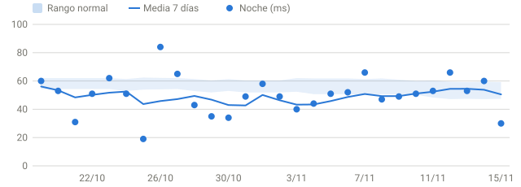
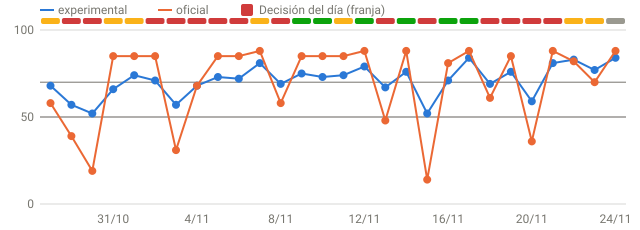
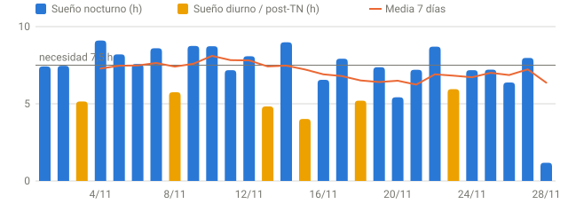
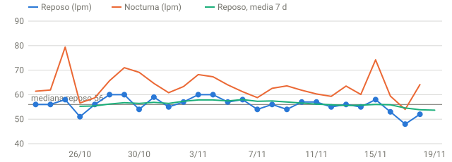
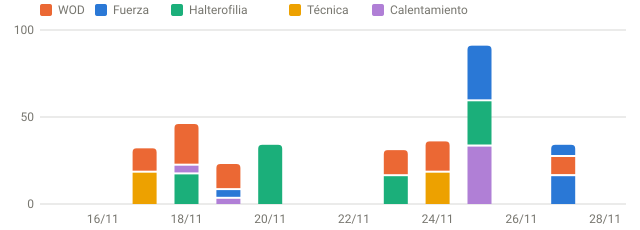
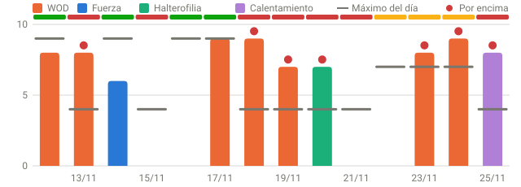
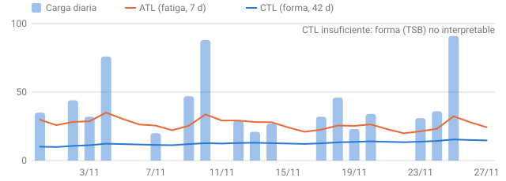

# Garmin Recovery · Informe de tarde

Lunes, 23 de noviembre de 2026 · 16:47 · `GR-2026-11-23-1647-5ea12e`

```cards
Decisión|Entrenar con control|RPE máx. 7|yellow
Recuperación oficial|70/100|confianza high|yellow
HRV|55 ms|+7 % vs mediana|green
Sueño|5 h 57 min|puntuación 77|unavailable
FC en reposo|55 lpm|mediana 56|unavailable
Carga 7 días|10 sesiones|sRPE 889|unavailable
```

## Resumen ejecutivo

- 🟢 **Certificación:** ciclo 2026-11-23-1645 validado; 4 de 4 procesos finalizados correctamente.
- 🟡 **Recuperación:** 70/100 (oficial, confianza high). Híbrido: 66/100. **Decisión: Entrenar con control**, RPE máx. 7.
- 🌙 **Sueño:** 5 h 57 min, puntuación 77/100.
- ❤️ **Principal alerta:** HRV 55 ms, 6,8 % por encima de tu mediana de 28 días.
- 🏋️ **Qué hacer:** Mantén técnica y fuerza submáxima; reduce volumen un 20–30 % y evita series al fallo y WOD máximos.

## 1. Certificación y calidad

| Comprobación | Resultado |
|---|---|
| Ciclo | 2026-11-23-1645 |
| Estado del certificado | READY |
| Sync | Correcto |
| Heart Rate | Correcto |
| Advanced Analytics | Correcto |
| CrossFit Insights | Correcto (publicando en este mismo ciclo) |
| Certificado generado | 16:47:13 |
| Instantánea inmutable (SHA-256) | Disponible |
| Confianza de recuperación | high |
| Calidad fisiológica de los datos | 100/100 (good) |

⚠️ Franjas de Sync sin ejecutar o recuperadas tarde: 11-22 08:30.

La calidad describe los datos disponibles, no el software. No se han incorporado mediciones posteriores al ciclo.

### Fuentes de datos

| Fuente | Último dato | Estado |
|---|---|---|
| Intervals.icu · bienestar (HRV, FC reposo, sueño) | 2026-11-23 | 🟢 al día |
| Intervals.icu · actividades | 2026-11-23 | 🟢 descarga correcta (2026-11-23) |
| Garmin · FC diurna y nocturna | 2026-11-23 | 🟢 al día |
| Garmin · estrés | 2026-11-23 | 🟢 al día |
| Garmin · Body Battery | 2026-11-23 | 🟢 al día |
| Garmin · Training Readiness y tiempo de recuperación | 2026-11-23 | 🟢 al día |
| Garmin · sueño | 2026-11-23 | 🟢 al día |

_Un retraso de un día es normal a primera hora; se avisa por GitHub si Intervals falla tres veces seguidas._

## 2. Recuperación fisiológica

| Indicador | Hoy | Mediana fusionada 28 días | Días |
|---|---|---|---|
| HRV | 55 ms | 52 ms | 28 |
| FC en reposo | 55 lpm | 56 lpm | 28 |
| FC nocturna | 59,6 lpm | 62,2 lpm | 28 |
| Duración del sueño | 5 h 57 min | 7 h 34 min | 28 |
| Puntuación de sueño | 77 | 79 | 28 |

Las referencias son medianas históricas, no objetivos.

La HRV está 7 % por encima de su mediana; la FC en reposo está 1 lpm por debajo.





### Modelos de recuperación

| Modelo | Resultado | Papel |
|---|---|---|
| Recuperación oficial | 🟡 70/100 | oficial |
| Híbrido Garmin + local | 🟡 66/100 | salvaguarda |
| Modelo experimental | 🟢 78/100 | sombra |
| Modelo de compatibilidad | 🟡 65/100 | compatibilidad |
| Garmin Training Readiness | ⚪ 68/100 | contexto |
| Tiempo de recuperación Garmin | 7,7 h | contexto |
| Índice personal experimental | 100/100 | provisional |

_Divergencia entre modelos:_ El modelo experimental (verde) es más permisivo que la decisión (ámbar); se aplica la más conservadora.

**Qué ha cambiado frente a tu último sueño tras turno de noche (18/11)**

Hoy dormiste de día tras el turno de noche: se compara con tu último sueño tras turno, no con la noche anterior. Modelo experimental: 69 → 78 (yellow → green). Cambios notables frente a tu último sueño tras turno de noche (18/11):

- HRV: 48 → 55 ms (favorable)
- FC en reposo: 52 → 55 lpm (desfavorable)
- FC nocturna: 64,1 → 59,6 lpm (favorable)
- Sueño: 5,2 → 6,0 h (favorable)
- Puntuación de sueño: 53 → 77 (favorable)
- Estrés medio: 30 → 17 (favorable)

Son diferencias observadas, no causas.

Las puntuaciones no son equivalentes entre sí. La decisión es la zona más conservadora entre el modelo oficial, el híbrido y el experimental; un rojo prevalece. El índice personal es provisional y no es una medida clínica.

## 3. Sueño y recuperación nocturna

Episodio confirmado: 23 de noviembre de 2026, 05:38 → 23 de noviembre de 2026, 11:35.

| Dato | Valor |
|---|---|
| Duración efectiva | 5 h 57 min |
| Puntuación | 77/100 |
| Sueño profundo | 1 h 11 min |
| Sueño REM | 1 h 28 min |

El REM representa un 25 % y el sueño profundo un 20 % del episodio.




**Necesidad y deuda de sueño**

| Componente | Horas |
|---|---|
| Base configurada | 7,5 |
| Recargo por carga de ayer | +0,0 |
| Recargo por deuda de las últimas 3 noches | +0,9 |
| Siesta de hoy | −0,0 |
| **Necesidad estimada esta noche** | **8,4 h** |
| Deuda de las últimas 3 noches (siestas descontadas) | 1,9 h |
| Deuda de 7 noches (siestas descontadas) | 6,4 h |

Es una estimación heurística, no validada; los recargos tienen tope y no sustituyen tu percepción. Solo cuentan siestas registradas por Garmin. El modelo experimental usa solo las últimas 3 noches y no descuenta siestas: por eso su deuda (1,9 h) puede ser mayor que la de 3 noches de esta tabla.

No se incorporan siestas no confirmadas.

## 4. Frecuencia cardíaca y tendencias

| Ventana | FC diurna | FC nocturna |
|---|---|---|
| Hoy* | 64,0 lpm | 59,6 lpm |
| 3 días | 68,2 lpm | 57,2 lpm |
| 7 días | 78,8 lpm | 59,2 lpm |
| 28 días | 79,4 lpm | 62,4 lpm |

\* La FC diurna de hoy es de un día parcial: no es FC en reposo.

Cobertura histórica fusionada (días con dato de 28):

| Indicador | Datos disponibles |
|---|---|
| HRV | 28/28 días |
| Sueño | 28/28 días |
| Puntuación de sueño | 28/28 días |
| FC en reposo | 28/28 días |



### Estrés y Body Battery

- Estrés medio: 17, máximo 74.
- Body Battery: último valor 74/100, medido a las 15:36.
- Recuperación de FC a 1 min tras el ejercicio: 7 observaciones recientes, mediana 24,0 lpm.

**Diario de correlaciones (HRV del día siguiente)**

| Factor | Con | Sin | HRV siguiente día (con / sin) | Diferencia |
|---|---|---|---|---|
| Día anterior con sesión registrada | 30 | 29 | 49,2 / 58,7 ms | **-9,5 ms** |
| Día anterior con turno de noche (TN) | 11 | 10 | 50,9 / 66,7 ms | **-15,8 ms** |
| Noche anterior de menos de 6,5 h | 18 | 40 | 52,3 / 54,5 ms | -2,2 ms (pequeña) |

Son asociaciones en tus propios datos de los últimos 90 días, sin causalidad ni prueba estadística; con pocos días pueden ser casualidad.

**Calibración de la zona del día**

HRV de la noche siguiente frente a tu mediana de 90 días (53,0 ms):

| Zona del día | Días | HRV siguiente noche vs mediana |
|---|---|---|
| 🟢 Verde | 11 | -1,1 ms |
| 🟡 Amarillo | 9 | -3,7 ms |
| 🔴 Rojo | 17 | +3,1 ms |

Solo descriptivo: sirve para ver si la zona se corresponde con tu recuperación posterior; no cambia umbrales.

## 5. Rendimiento CrossFit

Última actividad registrada: 23 nov. Descansos confirmados por ti: 2 en 7 días y 7 en 28. Un día sin registro y sin confirmar no demuestra que fuera de descanso.

Contraste Garmin ↔ Intervals: las 10 actividades de Garmin de los últimos 7 días constan también en Intervals.







### Últimos 7 días

| Métrica | Resultado |
|---|---|
| Sesiones registradas | 10 |
| Días con actividad | 4 |
| RPE medio | 7,50 |
| Sesiones de RPE ≥ 8 | 2 |
| Minutos grabados (Garmin) | 252,2 min |
| sRPE por duración registrada | 889 |
| TRIMP | 229,4 |
| Carga de actividades (Intervals) | 151 |
| Volumen externo mínimo verificado | 1500 kg |

El volumen es un mínimo cuantificable, no un tonelaje comparable entre barra, mancuernas y máquinas.

Últimos 28 días: 43 sesiones, RPE medio 7,29, TRIMP 1183,3 y 1344,4 minutos grabados.

### sRPE diario registrado

```
17 nov ██            93
18 nov ████████████  556
19 nov ███           157
20 nov ██            84
21 nov —             descanso
22 nov —             descanso
23 nov —             sin registro
```

El 18 nov concentra la mayor carga sRPE de la semana. La relación con las señales de recuperación es descriptiva, no causal.

Monotonía 0,64 · strain 570 (descriptores de contexto, sin umbral médico).

### Carrera

| Fecha | km | Tiempo | Ritmo (min/km) | FC media / máx. | m/latido | Cadencia (ppm) | Desnivel + | RPE |
|---|--:|--:|--:|--:|--:|--:|--:|--:|
| 28/10 | 8,02 | 41:13 | 5:09 | 157 / 177 | 1,24 | 163 | 54 m | 7,0 |
| 04/10 | 8,09 | 42:58 | 5:19 | 154 / 173 | 1,22 | 164 | 69 m | 8,0 |

Frente a la del 04/10 (8,09 km): 10 s/km más rápido, FC media +3 lpm; eficiencia parecida.

Metros por latido = velocidad (m/min) ÷ FC media. Comparaciones descriptivas entre carreras de distancia parecida (±25 %); el calor, el desnivel, el cansancio previo y el sensor también influyen.

## 6. Fuerza, halterofilia y metcons

- **20 nov — Fuerza - chin up lastrado EMOM 4x2 + 4x1 (+ calentamiento)** · FC media 136 / máx. 185 lpm · TRIMP 48 · ⚠️ RPE bajo para tu FC: la FC fue alta para el esfuerzo que marcaste
  Calentamiento + chin up estricto con lastre en EMOM: calentamiento 3x2 (peso corporal, +5, +10 kg); 4x2 con +15, +20, +25 y +30 kg; 4x1 con +35, +37,5, +40 y +42,5 kg. Mejor single registrado: +42,5 kg. Sin RPE: parte no puntuada por decisión del atleta. Tramo 0:00–31:26 de la actividad (31,4 min).
- **20 nov — WOD AMRAP 12' - DB clean & jerk / bar muscle-up / push-ups** · RPE 7
  AMRAP 12': 12 DB clean & jerk con 22,5 kg + 4 bar muscle-ups + 8 push-ups. Resultado 4 rondas + 15 (12 C&J y 3 bar muscle-ups; falló el 4.º muscle-up de la ronda 5) = 111 repeticiones. Totales: 60 C&J (1.350 kg), 19 bar muscle-ups, 32 push-ups. Hito: hasta 4 bar muscle-ups seguidos. RPE 7 a nivel cardiovascular. Tramo 31:26–43:26 de la actividad (12 min).
- **19 nov — WOD E3MO3M x5 - box jump over / burpee over the line / V-sit up** · RPE 7 · FC media 146 / máx. 179 lpm · TRIMP 22
  E3MO3M, 5 rondas (15'): 12 box jump over a 60 cm + 20 burpees over the line (pizarra: over DB) + 12 V-sit ups. Completo. Totales: 60 box jump over, 100 burpees, 60 V-sit ups. RPE 7. Garmin 14,8 min.
- **19 nov — Fuerza - DB split squat con déficit / ring row pies elevados** · RPE 6 · FC media 126 / máx. 153 lpm · TRIMP 8 · ⚠️ RPE bajo para tu FC: la FC fue alta para el esfuerzo que marcaste
  Fuerza cada 2' (semana 5), 4 series: DB split squat 4x8 (4 por pierna) con 32,5 kg en cada mano (65 kg en total) y déficit con el pie delantero sobre disco de 25 kg; feet elevated ring row 4x12 con pies a 60 cm. Volumen split squat 2.080 kg. RPE 6. Garmin 8,9 min.
- **19 nov — Calentamiento** · FC media 97 / máx. 127 lpm · TRIMP 5
  Calentamiento. Sin RPE: sesión no puntuada por decisión del atleta. Garmin 13,3 min.
- **18 nov — WOD EMOM 25' - DB deadlift / cal SkiErg-remo / DB push press / wall walk** · RPE 9 · FC media 147 / máx. 193 lpm · TRIMP 38 · ⚠️ RPE alto para tu FC: te costó más de lo habitual en este tipo de sesión
  EMOM 25' (5 rondas de 5 min): min 1 15 dual DB deadlift, min 2 16 cal alternando SkiErg y remo, min 3 15 double DB push press, min 4 3 wall walks (pizarra: 5), min 5 descanso. Mancuernas de 22,5 kg. Totales: 75 deadlift (3.375 kg), 80 cal, 75 push press (3.375 kg), 15 wall walks (todos los minutos completados, confirmado). RPE 9. Garmin 24,4 min.
- **18 nov — Calentamiento - WOD** · FC media 105 / máx. 149 lpm · TRIMP 7
  Calentamiento del WOD. Sin RPE: sesión no puntuada por decisión del atleta. Garmin 14,6 min.
- **18 nov — Halterofilia - 3-position squat snatch 5x1 + squat snatch 5x3** · RPE 7 · volumen de barra cuantificado 1500 kg · FC media 108 / máx. 157 lpm · TRIMP 26 · ⚠️ RPE alto para tu FC: te costó más de lo habitual en este tipo de sesión
  Calentamiento + 3-position squat snatch cada 1'30" (1 repetición = complejo seguido de 3 snatch: desde la cadera, hang squat snatch y squat snatch desde el suelo): calentamiento 5 con barra vacía, 1 a 30, 1 a 35, 1 a 38 kg (sin RPE); trabajo 38, 40, 43, 45 y 48 kg, volumen 642 kg. Squat snatch 5x3 cada 2' (10" entre reps): 50, 55, 58, 60 y 63 kg, volumen 858 kg. Volumen de trabajo 1.500 kg. RPE 7 de toda la sesión.…
- **17 nov — WOD For Time 50-40-30-20-10 - wall ball / DB snatch / C2B / DB thruster / devil press** · RPE 9 · FC media 167 / máx. 178 lpm · TRIMP 26
  For Time (TC 11'): 50 wall balls 9 kg, 40 dumbbell snatch, 30 chest-to-bar pull-ups, 20 single arm DB thruster, 10 one arm devil press; mancuerna de 22,5 kg. Terminado en 9:55. Volúmenes: wall ball 450 kg, DB snatch 900 kg, thruster 450 kg, devil press 225 kg. RPE 9. Garmin 10,3 min.
- **17 nov — Técnica - kipping y butterfly pull-up (+ calentamiento)** · FC media 109 / máx. 162 lpm · TRIMP 26
  Calentamiento + técnica de kipping y butterfly pull-up; consiguió enlazar 2 bar muscle-ups. Sin RPE: sesión no puntuada por decisión del atleta. Garmin 43,9 min.

RPE frente a FC: se marcan las sesiones cuyo esfuerzo relativo, ln(sRPE / carga de FC) frente a tu historial del mismo tipo, se aleja ±1,5 desviaciones robustas. Es descriptivo y no cambia la decisión del día.

**Carga de fuerza por patrón**

| Patrón | 7 d: bloques · series | 7 d: barra (kg) | 28 d: bloques · series | 28 d: barra (kg) |
|---|---|---|---|---|
| Bíceps (aislamiento) | — | — | 2 · 8 | — |
| Pecho (aislamiento) | — | — | 2 · 8 | — |
| Core | — | — | 2 · 8 | — |
| Bisagra de cadera | — | — | 3 · 18 | 8.800 |
| Tirón horizontal | 1 · 4 | — | 3 · 11 | — |
| Empuje horizontal | — | — | 6 · 31 | 11.800 |
| Flexión de rodilla | — | — | 3 · 16 | — |
| Halterofilia | 2 · 10 | 1.500 | 10 · 85 | 8.702 |
| Otros | — | — | 1 · 4 | — |
| Sentadilla | 1 · 4 | — | 9 · 48 | 12.595 |
| Tirón vertical | 1 · 8 | — | 5 · 29 | — |

Solo series declaradas; «+» indica bloques sin número de series. El volumen en kg cuenta únicamente barra con carga total y volumen completo; no se suma entre equipos. Un patrón sin registros no demuestra que no se entrenara.

**Progresión por ejercicio (barra)**

| Ejercicio | Semana | Mejor serie | 1RM mínimo | Sesiones |
|---|---|---|---|---|
| 3-position squat snatch | 2026-S47 | 48 kg × 3 | 52,8 kg | 1 |
| clean pull | 2026-S45 | 90 kg × 1 | 90 kg | 1 |
| front squat | 2026-S44 | 70 kg × 1 | 70 kg | 1 |
| hang power clean | 2026-S45 | 90 kg × 1 | 90 kg | 1 |
| peso muerto | 2026-S41 | 170 kg × 5 | 198,3 kg | 1 |
| peso muerto | 2026-S46 | 180 kg × 3 | 198 kg | 1 |
| power clean | 2026-S45 | 90 kg × 1 | 90 kg | 1 |
| power clean + squat clean (complex 1+1) | 2026-S43 | 90 kg × 1 | 90 kg | 1 |
| power snatch | 2026-S46 | 60 kg × 5 | 70 kg | 1 |
| press banca | 2026-S44 | 90 kg × 6 | 108 kg | 1 |
| press banca | 2026-S45 | 90 kg × 6 | 108 kg | 1 |
| press banca | 2026-S46 | 90 kg × 6 | 108 kg | 1 |
| sentadilla con safety bar | 2026-S45 | 133 kg × 8 | 168,5 kg | 1 |
| sentadilla trasera | 2026-S41 | 170 kg × 2 | 181,3 kg | 2 |
| sentadilla trasera | 2026-S42 | 185 kg × 1 | 185 kg | 1 |
| sentadilla trasera | 2026-S46 | 140 kg × 6 | 168 kg | 1 |
| split jerk | 2026-S44 | 100 kg × 1 | 100 kg | 1 |
| split jerk | 2026-S45 | 103 kg × 1 | 103 kg | 1 |
| squat clean | 2026-S43 | 110 kg × 1 | 110 kg | 1 |
| squat clean | 2026-S44 | 100 kg × 1 | 100 kg | 1 |
| squat clean | 2026-S45 | 103 kg × 1 | 103 kg | 1 |
| squat snatch | 2026-S42 | 68 kg × 1 | 68 kg | 1 |
| squat snatch | 2026-S44 | 75 kg × 1 | 75 kg | 1 |
| squat snatch | 2026-S47 | 63 kg × 3 | 69,3 kg | 1 |

Diferencias entre las dos últimas semanas con datos: peso muerto: 1RM mínimo -0,3 kg entre 2026-S41 y 2026-S46; press banca: 1RM mínimo 0 kg entre 2026-S45 y 2026-S46; sentadilla trasera: 1RM mínimo -17 kg entre 2026-S42 y 2026-S46; split jerk: 1RM mínimo +3 kg entre 2026-S44 y 2026-S45; squat clean: 1RM mínimo +3 kg entre 2026-S44 y 2026-S45; squat snatch: 1RM mínimo -5,7 kg entre 2026-S44 y 2026-S47.

Solo barra con carga total. El 1RM es un límite inferior (Epley sin RIR) y no se deduce del RPE; las semanas sin registro no implican que no se entrenara ese ejercicio.

No se atribuyen desgloses no confirmados ni se comparan récords no equivalentes; se conserva la diferencia entre cronómetro oficial y reloj.

## 7. Balance y orientación

Turno: hoy libre tras la noche, mañana libre.
- Señales favorables: HRV en rango respecto a tu historial.

### Recomendaciones

1. **Entrenar con control** — Mantén técnica y fuerza submáxima; reduce volumen un 20–30 % y evita series al fallo y WOD máximos.
2. Ajusta la sesión de hoy con las reglas por tipo del informe del ciclo (`app/informe.md`).
3. Registra sensaciones y fatiga percibida en Intervals: ayudan a contextualizar la recuperación tras varios entrenamientos exigentes.

## 8. Análisis de mejora física y recuperación

Reglas explícitas sobre tus últimos 28 días, sin IA. Son criterios generales de entrenamiento y descanso, no un diagnóstico médico. Cuando los datos no bastan, lo dice y no concluye.

### Prioridades

| # | Área | Qué muestran tus datos | Qué hacer |
|---|---|---|---|
| 1 | Sueño | Media de 7 noches: 7,4 h (necesidad configurada 7,5 h); 2 de 7 noches más de media hora por debajo; deuda acumulada 6,4 h (cuenta también el sueño diurno tras turno y descuenta las siestas registradas). | Adelanta la hora de acostarte 30–45 min esta semana, sobre todo antes de un turno. |
| 2 | Distribución de la intensidad | 11 de 28 sesiones con RPE registrado fueron de RPE ≥ 8 (39 %); 5 veces hubo dos días duros seguidos. | Intercala sesiones de RPE 5–6 entre las duras y deja ≥ 48 h entre dos esfuerzos máximos. |
| 3 | Registro de sensaciones | Sensaciones (fatiga, agujetas, estrés, ánimo, motivación) registradas en 0 de los últimos 14 días. | Apunta cada mañana en Intervals 1–5 de fatiga, agujetas y ánimo (20 segundos). |

### Detalle por área

- ✅ **HRV.** HRV media de los últimos 7 días: 58,5 ms frente a tu base de 53 ms (+10 %); tu rango normal es 47,7–58,8 ms. Es la misma media (logarítmica) que usa la puntuación. Tendencia por encima de tu referencia: buena señal de recuperación.
- ✅ **FC en reposo.** FC en reposo de los últimos 7 días: 52,4 lpm frente a 57,0 de referencia (-4,6 lpm). En línea con tu referencia.
- ⚠️ **Sueño.** Media de 7 noches: 7,4 h (necesidad configurada 7,5 h); 2 de 7 noches más de media hora por debajo; deuda acumulada 6,4 h (cuenta también el sueño diurno tras turno y descuenta las siestas registradas). El sueño es el principal factor de recuperación y de adaptación al entrenamiento.
- ✅ **Regularidad del sueño.** Hora de acostarte (mediana 00:22) con una variación típica de ±43 min en 14 noches; 3 turnos TN en los últimos 14 días. Un horario irregular reduce la calidad del sueño; con turnos rotativos es difícil, pero el ancla (hora de despertar o de la siesta) ayuda.
- ⚠️ **Distribución de la intensidad.** 11 de 28 sesiones con RPE registrado fueron de RPE ≥ 8 (39 %); 5 veces hubo dos días duros seguidos. Una parte alta de sesiones muy duras, sobre todo en días consecutivos, deja poco margen de recuperación y limita la mejora.
- ✅ **Respuesta a las sesiones duras.** HRV la mañana siguiente: 50 ms tras sesión de RPE ≥ 8 (n=11) frente a 45 ms tras las demás (n=7); diferencia +5 ms. Es una relación descriptiva con pocos días, no demuestra causa.
- ✅ **Fuerza.** Mejor valor registrado en 28 días: peso muerto 198 kg; sentadilla trasera 185 kg; sentadilla con safety bar 168 kg. Es un mínimo estimado (Epley sin RIR) o la carga máxima declarada: solo se comparan series con las mismas repeticiones.
- ⚠️ **Registro de sensaciones.** Sensaciones (fatiga, agujetas, estrés, ánimo, motivación) registradas en 0 de los últimos 14 días. Las sensaciones son el contraste más barato frente a los números del reloj: sin ellas, la app solo ve la parte objetiva. Además: 1 sesiones de 28 días sin RPE y HRV con dato en 14 de 14 días.

### Constancia semanal (últimas 4 semanas)

| Semana (lunes) | Sesiones | Días con actividad | sRPE |
|---|---|---|---|
| 02/11 | 9 | 4 | 1114 |
| 09/11 | 12 | 5 | 2140 |
| 16/11 | 9 | 4 | 889 |
| 23/11 | 1 | 1 | 0 |

_La semana en curso está incompleta; compara solo semanas completas._

### Semana a semana

Última semana completa (lunes 16/11) frente a la anterior (lunes 09/11). La semana en curso (1 de 7 días, hoy incluido) se muestra aparte y no se compara. Son diferencias descriptivas, no explican causas.

| Métrica | Sem. 09/11 | Sem. 16/11 | Cambio | En curso | 4 semanas |
|---|---|---|---|---|---|
| HRV nocturna | 52 (7 d) | 63 (7 d) | ✅ +11 ms (+21 %) | 55 (1 d) | `▁▂█▄` |
| FC en reposo | 56,0 (7 d) | 52,1 (7 d) | ✅ −3,9 lpm | 55,0 (1 d) | `█▆▁▅` |
| Sueño | 7,2 (7 d) | 6,9 (7 d) | ≈ −0,3 h | 6,0 (1 d) | `█▇▆▁` |
| Puntuación de sueño | 72 (7 d) | 71 (7 d) | ≈ −1 | 77 (1 d) | `▃▂▁█` |
| Sesiones | 12 | 9 | −3 | 1 |  |
| Días con actividad | 5 | 4 | −1 | 1 |  |
| sRPE total | 2140 | 889 | −1251 (−58 %) | 0 | `▅█▄▁` |

_Barras: ▁ valor más bajo, █ más alto de las últimas 4 semanas; «·» sin datos suficientes._

### Plan orientativo de 7 días

| Día | Turno | Sesión sugerida | Motivo |
|---|---|---|---|
| lun 23/11 | tras TN | 🟢 Suave / movilidad | ya has entrenado hoy |
| mar 24/11 | libre | 🔥 Exigente | día libre con margen para una sesión exigente |
| mié 25/11 | libre | 🟡 Moderada | día libre; sesión moderada para respetar el espaciado |
| jue 26/11 | MT | 🟢 Suave / movilidad | turno largo: movilidad o descanso |
| vie 27/11 | TN | 🟡 Moderada | TN por la tarde: si entrenas, por la mañana y moderado |
| sáb 28/11 | tras TN | 🛌 Descanso | día posterior a una TN: prioriza dormir |
| dom 29/11 | libre | 🔥 Exigente | día libre con margen para una sesión exigente |

Plan orientativo por reglas (máx. 3 sesiones con RPE ≥ 8 por semana, separadas ≥ 48 h, solo en días libres). Se recalcula en cada informe y la decisión del día manda sobre él.

### Reglas para los próximos 7 días

1. **Hoy:** respeta la decisión del día (Entrenar con control, RPE máx. 7).
2. **Esfuerzos máximos:** como mucho 2–3 sesiones de RPE ≥ 8 en la semana y separadas ≥ 48 h.
3. **Sueño:** suma 30–45 min cada noche en lugar de una sola noche larga; antes de un turno de noche, siesta corta.
4. **Registro:** fatiga, agujetas y ánimo cada mañana en Intervals; RPE de cada sesión el mismo día.
5. **Reevaluación:** dentro de 7 días compara tu HRV media y tu FC en reposo con la referencia de 28 días.

_Los puntos 2 y 3 son criterios generales de entrenamiento y descanso, no una prescripción personalizada._

## Conclusión

Datos suficientes para evaluar la recuperación de hoy: la decisión es **🟡 Entrenar con control**. No es un diagnóstico médico. Que el informe esté publicado no prueba que se haya leído una notificación.

---

Traza: informe de tarde · ciclo 2026-11-23-1645 · generado 23/11/2026 16:47 Europe/Madrid · certificado READY · sync_run_id 45208809008.
