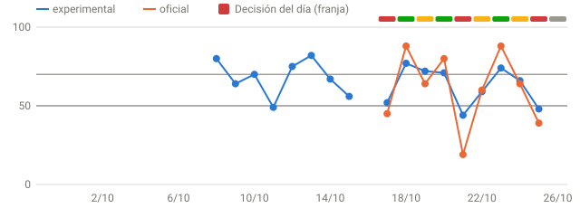
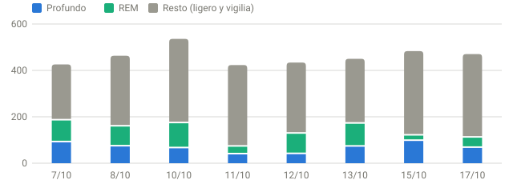

# Garmin Recovery · Cierre matinal

Lunes, 26 de octubre de 2026 · 09:06 · `GR-2026-10-26-0906-6351d7`

```cards
Decisión|Pendiente de datos|RPE máx. 6|unavailable
Recuperación oficial|88/100|confianza high|green
HRV|84 ms|+50 % vs mediana|green
Sueño|8 h 07 min|puntuación 96|unavailable
FC en reposo|51 lpm|mediana 56|unavailable
Carga 7 días|4 sesiones|sRPE 200|unavailable
```

## Resumen ejecutivo

- 🟢 **Certificación:** ciclo 2026-10-26-0830 validado; 4 de 4 procesos finalizados correctamente.
- ⚪ **Recuperación:** 88/100 (oficial, confianza high). Híbrido: 89/100. **Decisión: Pendiente de datos**, RPE máx. 6.
- 🌙 **Sueño:** 8 h 07 min, puntuación 96/100.
- ❤️ **Principal alerta:** HRV 84 ms, 50,0 % por encima de tu mediana de 28 días.
- 🏋️ **Qué hacer:** Faltan datos de hoy: no se autoriza intensidad alta. Reevaluar tras sincronizar el sueño.

## 1. Certificación y calidad

| Comprobación | Resultado |
|---|---|
| Ciclo | 2026-10-26-0830 |
| Estado del certificado | READY |
| Sync | Correcto |
| Heart Rate | Correcto |
| Advanced Analytics | Correcto |
| CrossFit Insights | Correcto (publicando en este mismo ciclo) |
| Certificado generado | 08:33:04 |
| Instantánea inmutable (SHA-256) | Disponible |
| Confianza de recuperación | high |
| Calidad fisiológica de los datos | 89/100 (good) |

La calidad describe los datos disponibles, no el software. No se han incorporado mediciones posteriores al ciclo.

### Fuentes de datos

| Fuente | Último dato | Estado |
|---|---|---|
| Intervals.icu · bienestar (HRV, FC reposo, sueño) | 2026-10-26 | 🟢 al día |
| Intervals.icu · actividades | 2026-10-23 | 🟢 descarga correcta (2026-10-26) |
| Garmin · FC diurna y nocturna | 2026-10-26 | 🟢 al día |
| Garmin · estrés | 2026-10-26 | 🟢 al día |
| Garmin · Body Battery | 2026-10-26 | 🟢 al día |
| Garmin · Training Readiness y tiempo de recuperación | 2026-10-26 | 🟢 al día |
| Garmin · sueño | 2026-10-26 | 🟢 al día |

_Un retraso de un día es normal a primera hora; se avisa por GitHub si Intervals falla tres veces seguidas._

## 2. Recuperación fisiológica

| Indicador | Hoy | Mediana fusionada 28 días | Días |
|---|---|---|---|
| HRV | 84 ms | 56 ms | 27 |
| FC en reposo | 51 lpm | 56 lpm | 28 |
| FC nocturna | 56,3 lpm | 62,2 lpm | 28 |
| Duración del sueño | 8 h 07 min | 7 h 16 min | 28 |
| Puntuación de sueño | 96 | 70 | 26 |

Las referencias son medianas históricas, no objetivos.

La HRV está 50 % por encima de su mediana; la FC en reposo está 5 lpm por debajo.




### Modelos de recuperación

| Modelo | Resultado | Papel |
|---|---|---|
| Recuperación oficial | 🟢 88/100 | oficial |
| Híbrido Garmin + local | 🟢 89/100 | salvaguarda |
| Modelo experimental | — | sombra |
| Modelo de compatibilidad | 🟢 100/100 | compatibilidad |
| Garmin Training Readiness | ⚪ 72/100 | contexto |
| Tiempo de recuperación Garmin | 0,0 h | contexto |
| Índice personal experimental | 100/100 | provisional |

**Qué ha cambiado desde ayer**

Modelo experimental: 48 → 76 (red → green). Cambios notables frente a ayer:

- HRV: 19 → 84 ms (favorable)
- FC en reposo: 58 → 51 lpm (favorable)
- FC nocturna: 79,4 → 56,3 lpm (favorable)
- Puntuación de sueño: 42 → 96 (favorable)
- Estrés medio: 56 → 9 (favorable)

Son diferencias observadas, no causas.

Las puntuaciones no son equivalentes entre sí. La decisión es la zona más conservadora entre el modelo oficial, el híbrido y el experimental; un rojo prevalece. El índice personal es provisional y no es una medida clínica.

## 3. Sueño y recuperación nocturna

Episodio confirmado: 26 de octubre de 2026, 00:29 → 26 de octubre de 2026, 08:38.

| Dato | Valor |
|---|---|
| Duración efectiva | 8 h 07 min |
| Puntuación | 96/100 |
| Sueño profundo | 1 h 19 min |
| Sueño REM | 1 h 51 min |

El REM representa un 23 % y el sueño profundo un 16 % del episodio.




**Necesidad y deuda de sueño**

| Componente | Horas |
|---|---|
| Base configurada | 7,5 |
| Recargo por carga de ayer | +0,0 |
| Recargo por deuda de las últimas 3 noches | +1,0 |
| Siesta de hoy | −0,0 |
| **Necesidad estimada esta noche** | **8,5 h** |
| Deuda de las últimas 3 noches (siestas descontadas) | 2,0 h |
| Deuda de 7 noches (siestas descontadas) | 3,9 h |

Es una estimación heurística, no validada; los recargos tienen tope y no sustituyen tu percepción. Solo cuentan siestas registradas por Garmin. El modelo experimental usa solo las últimas 3 noches y no descuenta siestas: por eso su deuda (2,0 h) puede ser mayor que la de 3 noches de esta tabla.

No se incorporan siestas no confirmadas.

## 4. Frecuencia cardíaca y tendencias

| Ventana | FC diurna | FC nocturna |
|---|---|---|
| Hoy* | 68,4 lpm | 56,3 lpm |
| 3 días | 79,2 lpm | 66,5 lpm |
| 7 días | 80,6 lpm | 66,0 lpm |
| 28 días | 83,1 lpm | 64,2 lpm |

\* La FC diurna de hoy es de un día parcial: no es FC en reposo.

Cobertura histórica fusionada (días con dato de 28):

| Indicador | Datos disponibles |
|---|---|
| HRV | 27/28 días |
| Sueño | 28/28 días |
| Puntuación de sueño | 26/28 días |
| FC en reposo | 28/28 días |


### Estrés y Body Battery

- Estrés medio: 9, máximo 51.
- Body Battery: último valor 100/100, medido a las 07:54.
- Recuperación de FC a 1 min tras el ejercicio: 3 observaciones recientes, mediana 16,0 lpm (insuficientes para una tendencia robusta).

**Diario de correlaciones (HRV del día siguiente)**

| Factor | Con | Sin | HRV siguiente día (con / sin) | Diferencia |
|---|---|---|---|---|
| Día anterior con sesión registrada | 11 | 20 | 49,7 / 57,1 ms | **-7,4 ms** |
| Día anterior con turno de noche (TN) | 5 | 5 | 56,6 / 66,4 ms | **-9,8 ms** |
| Noche anterior de menos de 6,5 h | 11 | 19 | 48,9 / 57,5 ms | **-8,6 ms** |

Son asociaciones en tus propios datos de los últimos 90 días, sin causalidad ni prueba estadística; con pocos días pueden ser casualidad.

**Calibración de la zona del día**

HRV de la noche siguiente frente a tu mediana de 90 días (56,0 ms):

| Zona del día | Días | HRV siguiente noche vs mediana |
|---|---|---|
| 🟢 Verde | 3 | datos insuficientes (mín. 5) |
| 🟡 Amarillo | 3 | datos insuficientes (mín. 5) |
| 🔴 Rojo | 3 | datos insuficientes (mín. 5) |

Solo descriptivo: sirve para ver si la zona se corresponde con tu recuperación posterior; no cambia umbrales.

## 5. Rendimiento CrossFit

Última actividad registrada: 23 oct. Un día sin registro no demuestra que fuera de descanso.

Contraste Garmin ↔ Intervals: las 4 actividades de Garmin de los últimos 7 días constan también en Intervals.


### Últimos 7 días

| Métrica | Resultado |
|---|---|
| Sesiones registradas | 4 |
| Días con actividad | 2 |
| RPE medio | 8,25 |
| Sesiones de RPE ≥ 8 | 2 |
| Minutos grabados (Garmin) | 75,5 min |
| sRPE por duración registrada | 200 |
| TRIMP | 75,6 |
| Carga de actividades (Intervals) | 50 |
| Volumen externo mínimo verificado | — |

El volumen es un mínimo cuantificable, no un tonelaje comparable entre barra, mancuernas y máquinas.

Últimos 28 días: 26 sesiones, RPE medio 7,38, TRIMP 578,0 y 662,9 minutos grabados.

### sRPE diario registrado

```
20 oct ███████████   24
21 oct —             sin registro
22 oct —             sin registro
23 oct ████████████  26
24 oct —             sin registro
25 oct —             sin registro
26 oct —             sin registro
```

El 23 oct concentra la mayor carga sRPE de la semana. La relación con las señales de recuperación es descriptiva, no causal.

## 6. Fuerza, halterofilia y metcons

- **23 oct — WOD AMRAP 10 min - deadlift / HSPU / box jump** · RPE 8,5 · FC media 149 / máx. 194 lpm · TRIMP 17
  AMRAP 10': 10 deadlift 80 kg + 10 handstand push-ups + 10 box jumps a 60 cm. Resultado 5 rondas + 2 deadlift = 152 repeticiones. 80 kg en todas las rondas. RPE 8,5. Garmin 11,1 min.
- **23 oct — Fuerza - chin up lastrado 4x5 + isometric pull up 4x10"** · FC media 114 / máx. 156 lpm · TRIMP 21
  Calentamiento + fuerza cada 1'30": chin up 4x5 con lastre de 5, 10, 15 y 15 kg; isometric pull up 4x10" con el mismo lastre que los chin up (5, 10, 15 y 15 kg). Tiempo Garmin 35,1 min (incluye calentamiento). Sin RPE: sesión no puntuada por decisión del atleta.
- **20 oct — WOD 5 Rounds For Time - wall ball / double unders / WB step up** · RPE 8 · FC media 159 / máx. 178 lpm · TRIMP 26 · ⚠️ RPE bajo para tu FC: la FC fue alta para el esfuerzo que marcaste
  5 rondas por tiempo con time cap de 13 min (no completado): 3 rondas + 20 wall ball + 30 double unders. Wall ball y WB step up con 9 kg. Garmin 13,2 min. Actividad emparejada por duración con el segundo HIIT del día (el primero, de 16 min, sin dictar).
- **20 oct — Fuerza - EMOM 8 min: DB split squat / ring row pies elevados** · FC media 120 / máx. 151 lpm · TRIMP 11
  EMOM 8 min: DB split squat 4x10 por pierna con 22,5 kg por mano (45 kg en total) y ring row con pies elevados 4x10 a peso corporal, alternando los ejercicios minuto a minuto (confirmado). Garmin 16,1 min (incluye calentamiento). Sin RPE: sesión no puntuada por decisión del atleta (21/10/2026; antes figuraba RPE 1).

RPE frente a FC: se marcan las sesiones cuyo esfuerzo relativo, ln(sRPE / carga de FC) frente a tu historial del mismo tipo, se aleja ±1,5 desviaciones robustas. Es descriptivo y no cambia la decisión del día.

**Carga de fuerza por patrón**

| Patrón | 7 d: bloques · series | 7 d: barra (kg) | 28 d: bloques · series | 28 d: barra (kg) |
|---|---|---|---|---|
| Pecho (aislamiento) | — | — | 1 · 4 | — |
| Core | — | — | 1 · 0 | — |
| Bisagra de cadera | — | — | 1 · 2 | 0 (parcial) |
| Empuje horizontal | — | — | 4 · 16 | — |
| Flexión de rodilla | — | — | 4 · 24 | — |
| other | 3 · 4 | — | 3 · 4 | — |
| Sentadilla | 1 · 4 | — | 10 · 67 | 14.318 |
| Tríceps (aislamiento) | — | — | 1 · 4 | — |

Solo series declaradas; «+» indica bloques sin número de series. El volumen en kg cuenta únicamente barra con carga total y volumen completo; no se suma entre equipos. Un patrón sin registros no demuestra que no se entrenara.

**Progresión por ejercicio (barra)**

| Ejercicio | Semana | Mejor serie | 1RM mínimo | Sesiones |
|---|---|---|---|---|
| fuerza - squat snatch emom 8 min | 2026-S42 | 68 kg × 1 | 68 kg | 1 |
| peso muerto | 2026-S41 | 170 kg × 5 | 198,3 kg | 1 |
| power clean + squat clean (complex 1+1) | 2026-S43 | 90 kg × 1 | 90 kg | 1 |
| sentadilla trasera | 2026-S41 | 170 kg × 2 | 181,3 kg | 2 |
| sentadilla trasera | 2026-S42 | 185 kg × 1 | 185 kg | 1 |
| squat clean | 2026-S43 | 110 kg × 1 | 110 kg | 1 |

Diferencias entre las dos últimas semanas con datos: sentadilla trasera: 1RM mínimo +3,7 kg entre 2026-S41 y 2026-S42.

Solo barra con carga total. El 1RM es un límite inferior (Epley sin RIR) y no se deduce del RPE; las semanas sin registro no implican que no se entrenara ese ejercicio.

No se atribuyen desgloses no confirmados ni se comparan récords no equivalentes; se conserva la diferencia entre cronómetro oficial y reloj.

## 7. Balance y orientación

Turno: hoy sin dato, mañana sin dato.
- Señales favorables: duración del sueño igual o superior a tu referencia; HRV en rango respecto a tu historial.

### Recomendaciones

1. **Pendiente de datos** — Faltan datos de hoy: no se autoriza intensidad alta. Reevaluar tras sincronizar el sueño.
2. Ajusta la sesión de hoy con las reglas por tipo del informe del ciclo (`app/informe.md`).
3. Registra sensaciones y fatiga percibida en Intervals: ayudan a contextualizar la recuperación tras varios entrenamientos exigentes.

## 8. Análisis de mejora física y recuperación

Reglas explícitas sobre tus últimos 28 días, sin IA. Son criterios generales de entrenamiento y descanso, no un diagnóstico médico. Cuando los datos no bastan, lo dice y no concluye.

### Prioridades

| # | Área | Qué muestran tus datos | Qué hacer |
|---|---|---|---|
| 1 | HRV | HRV media de los últimos 7 días: 50 ms frente a una referencia de 59 ms (-15 %). | Baja la intensidad unos días, protege el sueño y reevalúa en una semana. |
| 2 | Sueño | Media de 7 noches: 7,9 h (necesidad configurada 7,5 h); 1 de 7 noches más de media hora por debajo; deuda acumulada 3,9 h (cuenta también el sueño diurno tras turno y descuenta las siestas registradas). | Adelanta la hora de acostarte 30–45 min esta semana, sobre todo antes de un turno. |
| 3 | Distribución de la intensidad | 13 de 21 sesiones con RPE registrado fueron de RPE ≥ 8 (62 %); 4 veces hubo dos días duros seguidos. | Intercala sesiones de RPE 5–6 entre las duras y deja ≥ 48 h entre dos esfuerzos máximos. |

### Detalle por área

- 🔴 **HRV.** HRV media de los últimos 7 días: 50 ms frente a una referencia de 59 ms (-15 %). Una HRV sostenida por debajo de tu referencia suele acompañar a más fatiga o menos descanso.
- ✅ **FC en reposo.** FC en reposo de los últimos 7 días: 56,9 lpm frente a 56,0 de referencia (+0,9 lpm). En línea con tu referencia.
- ⚠️ **Sueño.** Media de 7 noches: 7,9 h (necesidad configurada 7,5 h); 1 de 7 noches más de media hora por debajo; deuda acumulada 3,9 h (cuenta también el sueño diurno tras turno y descuenta las siestas registradas). El sueño es el principal factor de recuperación y de adaptación al entrenamiento.
- ✅ **Regularidad del sueño.** Hora de acostarte (mediana 00:23) con una variación típica de ±60 min en 14 noches; 3 turnos TN en los últimos 14 días. Un horario irregular reduce la calidad del sueño; con turnos rotativos es difícil, pero el ancla (hora de despertar o de la siesta) ayuda.
- ⚠️ **Distribución de la intensidad.** 13 de 21 sesiones con RPE registrado fueron de RPE ≥ 8 (62 %); 4 veces hubo dos días duros seguidos. Una parte alta de sesiones muy duras, sobre todo en días consecutivos, deja poco margen de recuperación y limita la mejora.
- ⚠️ **Respuesta a las sesiones duras.** HRV la mañana siguiente: 48 ms tras sesión de RPE ≥ 8 (n=8) frente a 55 ms tras las demás (n=3); diferencia -7 ms. Es una relación descriptiva con pocos días, no demuestra causa.
- ✅ **Fuerza.** Mejor valor registrado en 28 días: peso muerto 198 kg; sentadilla trasera 185 kg; squat clean 110 kg. Es un mínimo estimado (Epley sin RIR) o la carga máxima declarada: solo se comparan series con las mismas repeticiones.
- ⚠️ **Registro de sensaciones.** Sensaciones (fatiga, agujetas, estrés, ánimo, motivación) registradas en 0 de los últimos 14 días. Las sensaciones son el contraste más barato frente a los números del reloj: sin ellas, la app solo ve la parte objetiva. Además: 5 sesiones de 28 días sin RPE y HRV con dato en 13 de 14 días.

### Constancia semanal (últimas 4 semanas)

| Semana (lunes) | Sesiones | Días con actividad | sRPE |
|---|---|---|---|
| 05/10 | 9 | 5 | 1420 |
| 12/10 | 9 | 4 | 1694 |
| 19/10 | 8 | 3 | 396 |
| 26/10 | 0 | 0 | 0 |

_La semana en curso está incompleta; compara solo semanas completas._

### Semana a semana

Última semana completa (lunes 19/10) frente a la anterior (lunes 12/10). La semana en curso (1 de 7 días, hoy incluido) se muestra aparte y no se compara. Son diferencias descriptivas, no explican causas.

| Métrica | Sem. 12/10 | Sem. 19/10 | Cambio | En curso | 4 semanas |
|---|---|---|---|---|---|
| HRV nocturna | 58 (6 d) | 47 (7 d) | ⚠️ −11 ms | 84 (1 d) | `▂▃▁█` |
| FC en reposo | 56,6 (7 d) | 57,1 (7 d) | ≈ +0,6 lpm | 51,0 (1 d) | `█▇█▁` |
| Sueño | 6,6 (7 d) | 6,8 (7 d) | ≈ +0,2 h | 8,1 (1 d) | `▃▁▂█` |
| Puntuación de sueño | 76 (5 d) | 62 (7 d) | ⚠️ −14 | 96 (1 d) | `▃▄▁█` |
| Sesiones | 9 | 8 | −1 | 0 |  |
| Días con actividad | 4 | 3 | −1 | 0 |  |
| sRPE total | 1694 | 396 | −1298 (−77 %) | 0 | `▇█▃▁` |

_Barras: ▁ valor más bajo, █ más alto de las últimas 4 semanas; «·» sin datos suficientes._

### Plan orientativo de 7 días

| Día | Turno | Sesión sugerida | Motivo |
|---|---|---|---|
| lun 26/10 | free | 🟢 Suave / movilidad | la decisión de hoy limita la intensidad |
| mar 27/10 | free | 🔥 Exigente | día libre con margen para una sesión exigente |
| mié 28/10 | free | 🟡 Moderada | día libre; sesión moderada para respetar el espaciado |
| jue 29/10 | TN | 🟡 Moderada | TN por la tarde: si entrenas, por la mañana y moderado |
| vie 30/10 | post-TN | 🛌 Descanso | día posterior a una TN: prioriza dormir |
| sáb 31/10 | free | 🔥 Exigente | día libre con margen para una sesión exigente |
| dom 01/11 | MT | 🟢 Suave / movilidad | turno largo: movilidad o descanso |

Plan orientativo por reglas (máx. 3 sesiones con RPE ≥ 8 por semana, separadas ≥ 48 h, solo en días libres). Se recalcula en cada informe y la decisión del día manda sobre él.

### Reglas para los próximos 7 días

1. **Hoy:** respeta la decisión del día (Pendiente de datos, RPE máx. 6).
2. **Esfuerzos máximos:** como mucho 2–3 sesiones de RPE ≥ 8 en la semana y separadas ≥ 48 h.
3. **Sueño:** suma 30–45 min cada noche en lugar de una sola noche larga; antes de un turno de noche, siesta corta.
4. **Registro:** fatiga, agujetas y ánimo cada mañana en Intervals; RPE de cada sesión el mismo día.
5. **Reevaluación:** dentro de 7 días compara tu HRV media y tu FC en reposo con la referencia de 28 días.

_Los puntos 2 y 3 son criterios generales de entrenamiento y descanso, no una prescripción personalizada._

## Conclusión

Datos insuficientes para evaluar la recuperación de hoy: la decisión es **⚪ Pendiente de datos**. No es un diagnóstico médico. Que el informe esté publicado no prueba que se haya leído una notificación.

---

Traza: cierre matinal · ciclo 2026-10-26-0830 · generado 26/10/2026 09:06 Europe/Madrid · certificado READY · sync_run_id 40286349950.
