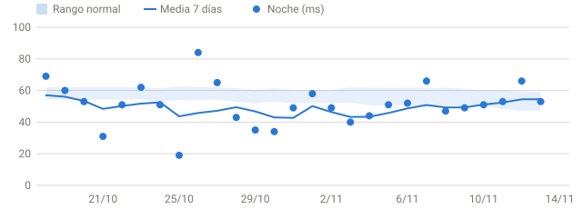
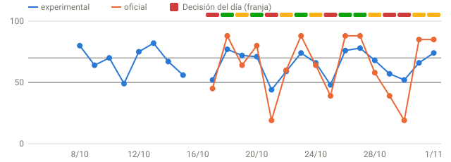
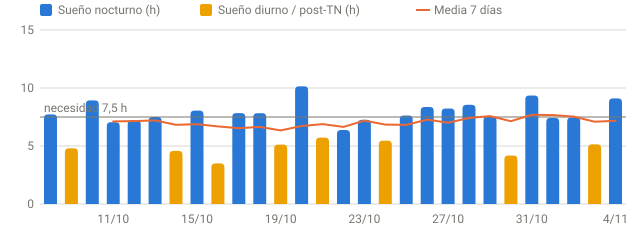
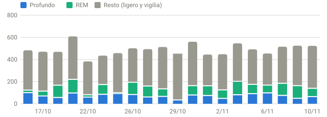
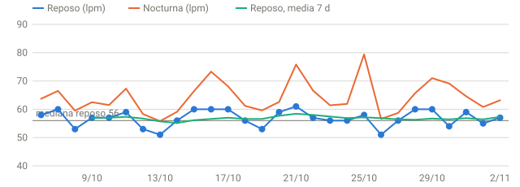
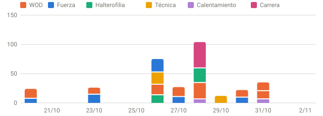
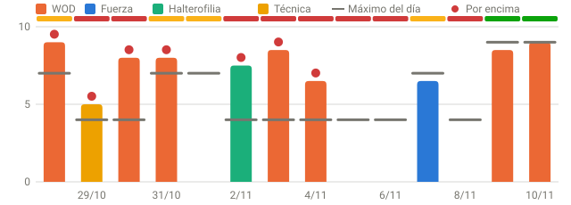
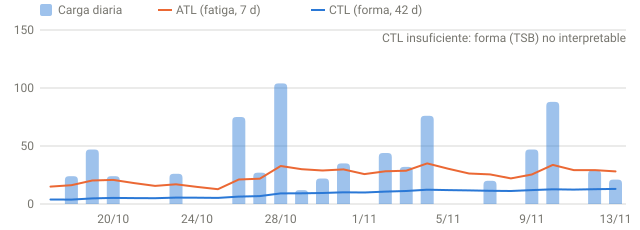

# Garmin Recovery · Cierre matinal

Martes, 10 de noviembre de 2026 · 09:27 · `GR-2026-11-10-0927-07b225`

```cards
Decisión|Listo para entrenar|RPE máx. 9|green
Recuperación oficial|85/100|confianza high|green
HRV|51 ms|0 % vs mediana|green
Sueño|8 h 44 min|puntuación 79|unavailable
FC en reposo|57 lpm|mediana 57|unavailable
Carga 7 días|8 sesiones|sRPE 1238|unavailable
```

## Resumen ejecutivo

- 🟢 **Certificación:** ciclo 2026-11-10-0830-post-sleep validado; 4 de 4 procesos finalizados correctamente.
- 🟢 **Recuperación:** 85/100 (oficial, confianza high). Híbrido: 81/100. **Decisión: Listo para entrenar**, RPE máx. 9.
- 🌙 **Sueño:** 8 h 44 min, puntuación 79/100.
- ❤️ **Principal alerta:** HRV 51 ms, 0,0 % por encima de tu mediana de 28 días.
- 🏋️ **Qué hacer:** Entrena según lo planificado. Intensidad alta permitida si el calentamiento responde bien.

## 1. Certificación y calidad

| Comprobación | Resultado |
|---|---|
| Ciclo | 2026-11-10-0830-post-sleep |
| Estado del certificado | READY |
| Sync | Correcto |
| Heart Rate | Correcto |
| Advanced Analytics | Correcto |
| CrossFit Insights | Correcto (publicando en este mismo ciclo) |
| Certificado generado | 09:27:53 |
| Instantánea inmutable (SHA-256) | Disponible |
| Confianza de recuperación | high |
| Calidad fisiológica de los datos | 100/100 (good) |

La calidad describe los datos disponibles, no el software. No se han incorporado mediciones posteriores al ciclo.

### Fuentes de datos

| Fuente | Último dato | Estado |
|---|---|---|
| Intervals.icu · bienestar (HRV, FC reposo, sueño) | 2026-11-10 | 🟢 al día |
| Intervals.icu · actividades | 2026-11-09 | 🟢 descarga correcta (2026-11-10) |
| Garmin · FC diurna y nocturna | 2026-11-10 | 🟢 al día |
| Garmin · estrés | 2026-11-10 | 🟢 al día |
| Garmin · Body Battery | 2026-11-10 | 🟢 al día |
| Garmin · Training Readiness y tiempo de recuperación | 2026-11-10 | 🟢 al día |
| Garmin · sueño | 2026-11-10 | 🟢 al día |

_Un retraso de un día es normal a primera hora; se avisa por GitHub si Intervals falla tres veces seguidas._

## 2. Recuperación fisiológica

| Indicador | Hoy | Mediana fusionada 28 días | Días |
|---|---|---|---|
| HRV | 51 ms | 51 ms | 27 |
| FC en reposo | 57 lpm | 57 lpm | 28 |
| FC nocturna | 61,8 lpm | 63,5 lpm | 28 |
| Duración del sueño | 8 h 44 min | 7 h 34 min | 28 |
| Puntuación de sueño | 79 | 75 | 26 |

Las referencias son medianas históricas, no objetivos.

La HRV está 0 % por encima de su mediana; la FC en reposo coincide con su mediana.





### Modelos de recuperación

| Modelo | Resultado | Papel |
|---|---|---|
| Recuperación oficial | 🟢 85/100 | oficial |
| Híbrido Garmin + local | 🟢 81/100 | salvaguarda |
| Modelo experimental | 🟢 75/100 | sombra |
| Modelo de compatibilidad | 🟢 91/100 | compatibilidad |
| Garmin Training Readiness | ⚪ 65/100 | contexto |
| Tiempo de recuperación Garmin | 17,5 h | contexto |
| Índice personal experimental | 84/100 | provisional |

**Qué ha cambiado desde ayer**

Modelo experimental: 75 → 75 (green → green). Cambios notables frente a ayer:

- FC en reposo: 54 → 57 lpm (desfavorable)
- Estrés medio: 29 → 19 (favorable)

Son diferencias observadas, no causas.

Las puntuaciones no son equivalentes entre sí. La decisión es la zona más conservadora entre el modelo oficial, el híbrido y el experimental; un rojo prevalece. El índice personal es provisional y no es una medida clínica.

## 3. Sueño y recuperación nocturna

Episodio confirmado: 9 de noviembre de 2026, 23:32 → 10 de noviembre de 2026, 08:50.

| Dato | Valor |
|---|---|
| Duración efectiva | 8 h 44 min |
| Puntuación | 79/100 |
| Sueño profundo | 1 h 00 min |
| Sueño REM | 1 h 15 min |

El REM representa un 14 % y el sueño profundo un 11 % del episodio.





**Necesidad y deuda de sueño**

| Componente | Horas |
|---|---|
| Base configurada | 7,5 |
| Recargo por carga de ayer | +0,2 |
| Recargo por deuda de las últimas 3 noches | +0,9 |
| Siesta de hoy | −0,0 |
| **Necesidad estimada esta noche** | **8,6 h** |
| Deuda de las últimas 3 noches (siestas descontadas) | 1,8 h |
| Deuda de 7 noches (siestas descontadas) | 1,8 h |

Es una estimación heurística, no validada; los recargos tienen tope y no sustituyen tu percepción. Solo cuentan siestas registradas por Garmin. El modelo experimental usa solo las últimas 3 noches y no descuenta siestas: por eso su deuda (1,8 h) puede ser mayor que la de 3 noches de esta tabla.

No se incorporan siestas no confirmadas.

## 4. Frecuencia cardíaca y tendencias

| Ventana | FC diurna | FC nocturna |
|---|---|---|
| Hoy* | 64,3 lpm | 61,8 lpm |
| 3 días | 73,2 lpm | 62,7 lpm |
| 7 días | 77,6 lpm | 62,8 lpm |
| 28 días | 81,8 lpm | 64,5 lpm |

\* La FC diurna de hoy es de un día parcial: no es FC en reposo.

Cobertura histórica fusionada (días con dato de 28):

| Indicador | Datos disponibles |
|---|---|
| HRV | 27/28 días |
| Sueño | 28/28 días |
| Puntuación de sueño | 26/28 días |
| FC en reposo | 28/28 días |



### Estrés y Body Battery

- Estrés medio: 19, máximo 57.
- Body Battery: último valor 83/100, medido a las 08:00.
- Recuperación de FC a 1 min tras el ejercicio: 7 observaciones recientes, mediana 21,0 lpm.

**Diario de correlaciones (HRV del día siguiente)**

| Factor | Con | Sin | HRV siguiente día (con / sin) | Diferencia |
|---|---|---|---|---|
| Día anterior con sesión registrada | 22 | 24 | 48,4 / 56,6 ms | **-8,2 ms** |
| Día anterior con turno de noche (TN) | 8 | 7 | 50,5 / 63,9 ms | **-13,4 ms** |
| Noche anterior de menos de 6,5 h | 14 | 31 | 48,6 / 54,3 ms | **-5,8 ms** |

Son asociaciones en tus propios datos de los últimos 90 días, sin causalidad ni prueba estadística; con pocos días pueden ser casualidad.

**Calibración de la zona del día**

HRV de la noche siguiente frente a tu mediana de 90 días (53,0 ms):

| Zona del día | Días | HRV siguiente noche vs mediana |
|---|---|---|
| 🟢 Verde | 6 | -2,8 ms |
| 🟡 Amarillo | 7 | -6,9 ms |
| 🔴 Rojo | 11 | +0,5 ms |

Solo descriptivo: sirve para ver si la zona se corresponde con tu recuperación posterior; no cambia umbrales.

## 5. Rendimiento CrossFit

Última actividad registrada: 9 nov. Descansos confirmados por ti: 2 en 7 días y 2 en 28. Un día sin registro y sin confirmar no demuestra que fuera de descanso.

Contraste Garmin ↔ Intervals: las 8 actividades de Garmin de los últimos 7 días constan también en Intervals.







### Últimos 7 días

| Métrica | Resultado |
|---|---|
| Sesiones registradas | 8 |
| Días con actividad | 3 |
| RPE medio | 6,50 |
| Sesiones de RPE ≥ 8 | 1 |
| Minutos grabados (Garmin) | 340,3 min |
| sRPE por duración registrada | 1238 |
| TRIMP | 235,0 |
| Carga de actividades (Intervals) | 143 |
| Volumen externo mínimo verificado | 15.443 kg |

El volumen es un mínimo cuantificable, no un tonelaje comparable entre barra, mancuernas y máquinas.

Últimos 28 días: 43 sesiones, RPE medio 7,36, TRIMP 1137,7 y 1306,7 minutos grabados.

### sRPE diario registrado

```
4 nov  ████████████  496
5 nov  —             descanso
6 nov  —             descanso
7 nov  █████████     391
8 nov  —             sin registro
9 nov  ████████      350
10 nov —             sin registro
```

El 4 nov concentra la mayor carga sRPE de la semana. La relación con las señales de recuperación es descriptiva, no causal.

Monotonía 0,79 · strain 974 (descriptores de contexto, sin umbral médico).

### Carrera

| Fecha | km | Tiempo | Ritmo (min/km) | FC media / máx. | m/latido | Cadencia (ppm) | Desnivel + | RPE |
|---|--:|--:|--:|--:|--:|--:|--:|--:|
| 28/10 | 8,02 | 41:13 | 5:09 | 157 / 177 | 1,24 | 163 | 54 m | 7,0 |
| 04/10 | 8,09 | 42:58 | 5:19 | 154 / 173 | 1,22 | 164 | 69 m | — |

Frente a la del 04/10 (8,09 km): 10 s/km más rápido, FC media +3 lpm; eficiencia parecida.

Metros por latido = velocidad (m/min) ÷ FC media. Comparaciones descriptivas entre carreras de distancia parecida (±25 %); el calor, el desnivel, el cansancio previo y el sensor también influyen.

## 6. Fuerza, halterofilia y metcons

- **9 nov — Técnica - handstand push-ups en déficit** · FC media 108 / máx. 139 lpm · TRIMP 22
  Técnica de handstand push-ups: hasta 5 repeticiones en déficit de un disco de 20 kg + un disco de 5 kg (el déficit se mide en discos, no en cm; series no desglosadas). Sin RPE: sesión no puntuada por decisión del atleta. Garmin 42,2 min.
- **9 nov — WOD 20-15-10-5 - power snatch / chest to bar** · RPE 8,5 · FC media 157 / máx. 188 lpm · TRIMP 17
  20-15-10-5 de power snatch 35 kg + chest-to-bar pull-ups (time cap 10 min): completado en 7:59 con chest to bar; 50 snatches (1.750 kg) y 50 C2B. RPE 8,5. El WOD empieza hacia el segundo 40 de la grabación Garmin (grabación 8:51).
- **9 nov — Fuerza - power snatch 5x5** · RPE 7 · volumen de barra cuantificado 1250 kg · FC media 128 / máx. 171 lpm · TRIMP 37
  Calentamiento + power snatch 5x5 cada 1'30": progresión barra vacía (20 kg) x5 y 30 kg x5; series de trabajo 5x40, 5x45, 5x50, 5x55, 5x60 kg (volumen de trabajo 1.250 kg). RPE 7. Garmin 39,2 min.
- **7 nov — Fuerza - pierna: sentadilla safety bar, péndulo, cuádriceps y femorales** · RPE 6,5 · volumen de barra cuantificado 6462 kg · FC media 111 / máx. 141 lpm · TRIMP 34
  Air squat 1x15. Sentadilla con safety bar (barra vacía 23 kg): 15x23, 12x63, 8x83, 8x103, 8x123, 8x133, 5x143, 3x153, 12x83 kg; volumen verificado 6.807 kg. Sentadilla péndulo 4x8 a 40/50/60/70 kg. Extensión de cuádriceps unilateral (por pierna): 15x20, 15x25, 10x30, 15x20 kg. Curl femoral tumbado 1x10 60 kg y 3x8 67 kg. Curl femoral de pie unilateral 4x8 con 35 kg por pierna. RPE 6,5 de toda la sesión. Cargas de má…
- **4 nov — Fuerza - pecho: press banca, inclinados, aperturas, bíceps y abdominales** · RPE 4 · volumen de barra cuantificado 5770 kg · FC media 103 / máx. 134 lpm · TRIMP 28
  Press banca: 40x20 (barra vacía), 20x40, 20x60, 15x60, 15x70, 8x80, 6x90, 8x80 kg; volumen de barra 5.770 kg sin la serie de barra vacía (6.570 kg con ella). Press inclinado mancuernas 1x8 con 31 kg y 3x8 con 33,5 kg por mancuerna. Press superinclinado isolateral 1x15 20 kg y 3x8 25 kg por lado. Aperturas en banco inclinado 4x10 con 16 kg por mancuerna. Curl bíceps máquina unilateral 1x15 10 kg y 3x8 15 kg por lado.…
- **4 nov — Halterofilia - complex squat clean + split jerk** · volumen de barra cuantificado 1961 kg · FC media 117 / máx. 151 lpm · TRIMP 43
  Calentamiento sin desglose. Complex 1 squat clean + 2 split jerk cada 1'30" (4 series): 60, 70, 75 y 80 kg. Complex 1 squat clean + 1 split jerk cada 2' (4 series): 80, 85, 90 y 95 kg. RM 1+1 en 15': 100 y 103 kg conseguidos, fallo en 105 kg. 24 repeticiones y 1.961 kg de volumen de trabajo. Garmin 70,3 min. Sin RPE: sesión no puntuada por decisión del atleta.
- **4 nov — WOD 4 x AMRAP 6 min - swing americano / sumo deadlift high pull** · RPE 6,5 · FC media 148 / máx. 194 lpm · TRIMP 46
  4 x AMRAP 6' con 2' de descanso, acumulando rondas entre bloques: 20 cal (alternando assault bike y remo, empezando en bike) + 15 swing americano + 10 sumo deadlift high pull, ambos con 24 kg. 8 rondas + 10 cal de assault bike (90 cal bike, 80 cal remo, 120 swings, 80 sumo deadlift high pull). RPE 6,5 con sensación de fatiga. Garmin 31,3 min.
- **4 nov — Calentamiento - previo al WOD** · FC media 111 / máx. 146 lpm · TRIMP 8
  Calentamiento con los ejercicios del WOD y menos peso, sin contar repeticiones. Garmin 14,9 min. Sin RPE: sesión no puntuada por decisión del atleta.

**Carga de fuerza por patrón**

| Patrón | 7 d: bloques · series | 7 d: barra (kg) | 28 d: bloques · series | 28 d: barra (kg) |
|---|---|---|---|---|
| Bíceps (aislamiento) | 1 · 4 | — | 2 · 8 | — |
| Pecho (aislamiento) | 1 · 4 | — | 2 · 8 | — |
| Core | 1 · 4 | — | 2 · 8 | — |
| Tirón horizontal | — | — | 2 · 7 | — |
| Empuje horizontal | 3 · 15 | 5.770 | 6 · 30 | 10.390 |
| Flexión de rodilla | 2 · 12 | — | 4 · 24 | — |
| Halterofilia | 3 · 25 | 3.211 | 12 · 97 | 9.671 |
| Otros | 1 · 4 | — | 1 · 4 | — |
| Sentadilla | 3 · 13 | 6.462 | 8 · 44 | 11.890 |
| Tirón vertical | — | — | 4 · 18 | — |

Solo series declaradas; «+» indica bloques sin número de series. El volumen en kg cuenta únicamente barra con carga total y volumen completo; no se suma entre equipos. Un patrón sin registros no demuestra que no se entrenara.

**Progresión por ejercicio (barra)**

| Ejercicio | Semana | Mejor serie | 1RM mínimo | Sesiones |
|---|---|---|---|---|
| clean pull | 2026-S45 | 90 kg × 1 | 90 kg | 1 |
| front squat | 2026-S44 | 70 kg × 1 | 70 kg | 1 |
| hang power clean | 2026-S45 | 90 kg × 1 | 90 kg | 1 |
| peso muerto | 2026-S41 | 170 kg × 5 | 198,3 kg | 1 |
| power clean | 2026-S45 | 90 kg × 1 | 90 kg | 1 |
| power clean + squat clean (complex 1+1) | 2026-S43 | 90 kg × 1 | 90 kg | 1 |
| power snatch | 2026-S46 | 60 kg × 5 | 70 kg | 1 |
| press banca | 2026-S44 | 90 kg × 6 | 108 kg | 1 |
| press banca | 2026-S45 | 90 kg × 6 | 108 kg | 1 |
| sentadilla con safety bar | 2026-S45 | 133 kg × 8 | 168,5 kg | 1 |
| sentadilla trasera | 2026-S41 | 170 kg × 2 | 181,3 kg | 2 |
| sentadilla trasera | 2026-S42 | 185 kg × 1 | 185 kg | 1 |
| split jerk | 2026-S44 | 100 kg × 1 | 100 kg | 1 |
| split jerk | 2026-S45 | 103 kg × 1 | 103 kg | 1 |
| squat clean | 2026-S43 | 110 kg × 1 | 110 kg | 1 |
| squat clean | 2026-S44 | 100 kg × 1 | 100 kg | 1 |
| squat clean | 2026-S45 | 103 kg × 1 | 103 kg | 1 |
| squat snatch | 2026-S42 | 68 kg × 1 | 68 kg | 1 |
| squat snatch | 2026-S44 | 75 kg × 1 | 75 kg | 1 |

Diferencias entre las dos últimas semanas con datos: press banca: 1RM mínimo 0 kg entre 2026-S44 y 2026-S45; sentadilla trasera: 1RM mínimo +3,7 kg entre 2026-S41 y 2026-S42; split jerk: 1RM mínimo +3 kg entre 2026-S44 y 2026-S45; squat clean: 1RM mínimo +3 kg entre 2026-S44 y 2026-S45; squat snatch: 1RM mínimo +7 kg entre 2026-S42 y 2026-S44.

Solo barra con carga total. El 1RM es un límite inferior (Epley sin RIR) y no se deduce del RPE; las semanas sin registro no implican que no se entrenara ese ejercicio.

No se atribuyen desgloses no confirmados ni se comparan récords no equivalentes; se conserva la diferencia entre cronómetro oficial y reloj.

## 7. Balance y orientación

Turno: hoy libre, mañana MT (08–22).
- Señales favorables: duración del sueño igual o superior a tu referencia; HRV en rango respecto a tu historial.

### Recomendaciones

1. **Listo para entrenar** — Entrena según lo planificado. Intensidad alta permitida si el calentamiento responde bien.
2. Ajusta la sesión de hoy con las reglas por tipo del informe del ciclo (`app/informe.md`).
3. Registra sensaciones y fatiga percibida en Intervals: ayudan a contextualizar la recuperación tras varios entrenamientos exigentes.

## 8. Análisis de mejora física y recuperación

Reglas explícitas sobre tus últimos 28 días, sin IA. Son criterios generales de entrenamiento y descanso, no un diagnóstico médico. Cuando los datos no bastan, lo dice y no concluye.

### Prioridades

| # | Área | Qué muestran tus datos | Qué hacer |
|---|---|---|---|
| 1 | HRV | HRV media de los últimos 7 días: 51,1 ms frente a tu base de 55 ms (-7 %); tu rango normal es 50,3–60,1 ms. Es la misma media (logarítmica) que usa la puntuación. | Evita acumular días muy exigentes seguidos y vigila el sueño. |
| 2 | Distribución de la intensidad | 15 de 29 sesiones con RPE registrado fueron de RPE ≥ 8 (52 %); 5 veces hubo dos días duros seguidos. | Intercala sesiones de RPE 5–6 entre las duras y deja ≥ 48 h entre dos esfuerzos máximos. |
| 3 | Registro de sensaciones | Sensaciones (fatiga, agujetas, estrés, ánimo, motivación) registradas en 0 de los últimos 14 días. | Apunta cada mañana en Intervals 1–5 de fatiga, agujetas y ánimo (20 segundos). |

### Detalle por área

- ⚠️ **HRV.** HRV media de los últimos 7 días: 51,1 ms frente a tu base de 55 ms (-7 %); tu rango normal es 50,3–60,1 ms. Es la misma media (logarítmica) que usa la puntuación. Tendencia algo por debajo de tu referencia.
- ✅ **FC en reposo.** FC en reposo de los últimos 7 días: 56,6 lpm frente a 57,0 de referencia (-0,4 lpm). En línea con tu referencia.
- ✅ **Sueño.** Media de 7 noches: 8,3 h (necesidad configurada 7,5 h); 0 de 7 noches más de media hora por debajo; deuda acumulada 1,8 h (cuenta también el sueño diurno tras turno y descuenta las siestas registradas). El sueño es el principal factor de recuperación y de adaptación al entrenamiento.
- ✅ **Regularidad del sueño.** Hora de acostarte (mediana 23:52) con una variación típica de ±61 min en 14 noches; 3 turnos TN en los últimos 14 días. Un horario irregular reduce la calidad del sueño; con turnos rotativos es difícil, pero el ancla (hora de despertar o de la siesta) ayuda.
- ⚠️ **Distribución de la intensidad.** 15 de 29 sesiones con RPE registrado fueron de RPE ≥ 8 (52 %); 5 veces hubo dos días duros seguidos. Una parte alta de sesiones muy duras, sobre todo en días consecutivos, deja poco margen de recuperación y limita la mejora.
- ✅ **Respuesta a las sesiones duras.** HRV la mañana siguiente: 47 ms tras sesión de RPE ≥ 8 (n=11) frente a 46 ms tras las demás (n=5); diferencia +1 ms. Es una relación descriptiva con pocos días, no demuestra causa.
- ✅ **Fuerza.** Mejor valor registrado en 28 días: peso muerto 198 kg; sentadilla trasera 185 kg; sentadilla con safety bar 168 kg. Es un mínimo estimado (Epley sin RIR) o la carga máxima declarada: solo se comparan series con las mismas repeticiones.
- ⚠️ **Registro de sensaciones.** Sensaciones (fatiga, agujetas, estrés, ánimo, motivación) registradas en 0 de los últimos 14 días. Las sensaciones son el contraste más barato frente a los números del reloj: sin ellas, la app solo ve la parte objetiva. Además: 0 sesiones de 28 días sin RPE y HRV con dato en 14 de 14 días.

### Constancia semanal (últimas 4 semanas)

| Semana (lunes) | Sesiones | Días con actividad | sRPE |
|---|---|---|---|
| 19/10 | 8 | 3 | 396 |
| 26/10 | 16 | 6 | 2195 |
| 02/11 | 9 | 4 | 1114 |
| 09/11 | 3 | 1 | 350 |

_La semana en curso está incompleta; compara solo semanas completas._

### Semana a semana

Última semana completa (lunes 02/11) frente a la anterior (lunes 26/10). La semana en curso (2 de 7 días, hoy incluido) se muestra aparte y no se compara. Son diferencias descriptivas, no explican causas.

| Métrica | Sem. 26/10 | Sem. 02/11 | Cambio | En curso | 4 semanas |
|---|---|---|---|---|---|
| HRV nocturna | 53 (7 d) | 50 (7 d) | ⚠️ −3 ms (−5 %) | 50 (2 d) | `▁█▅▅` |
| FC en reposo | 56,4 (7 d) | 57,4 (7 d) | ≈ +1,0 lpm | 55,5 (2 d) | `▇▄█▁` |
| Sueño | 7,7 (7 d) | 7,4 (7 d) | ≈ −0,3 h | 8,7 (2 d) | `▁▄▃█` |
| Puntuación de sueño | 73 (7 d) | 73 (7 d) | ≈ −1 | 81 (2 d) | `▁▅▅█` |
| Sesiones | 16 | 9 | −7 | 3 |  |
| Días con actividad | 6 | 4 | −2 | 1 |  |
| sRPE total | 2195 | 1114 | −1081 (−49 %) | 350 | `▁█▄▁` |

_Barras: ▁ valor más bajo, █ más alto de las últimas 4 semanas; «·» sin datos suficientes._

### Plan orientativo de 7 días

| Día | Turno | Sesión sugerida | Motivo |
|---|---|---|---|
| mar 10/11 | libre | 🟡 Moderada | día libre; sesión moderada para respetar el espaciado |
| mié 11/11 | MT | 🟢 Suave / movilidad | turno largo: movilidad o descanso |
| jue 12/11 | TN | 🟡 Moderada | TN por la tarde: si entrenas, por la mañana y moderado |
| vie 13/11 | tras TN | 🛌 Descanso | día posterior a una TN: prioriza dormir |
| sáb 14/11 | libre | 🔥 Exigente | día libre con margen para una sesión exigente |
| dom 15/11 | libre | 🟡 Moderada | día libre; sesión moderada para respetar el espaciado |
| lun 16/11 | MT | 🟢 Suave / movilidad | turno largo: movilidad o descanso |

Plan orientativo por reglas (máx. 3 sesiones con RPE ≥ 8 por semana, separadas ≥ 48 h, solo en días libres). Se recalcula en cada informe y la decisión del día manda sobre él.

### Reglas para los próximos 7 días

1. **Hoy:** respeta la decisión del día (Listo para entrenar, RPE máx. 9).
2. **Esfuerzos máximos:** como mucho 2–3 sesiones de RPE ≥ 8 en la semana y separadas ≥ 48 h.
3. **Sueño:** suma 30–45 min cada noche en lugar de una sola noche larga; antes de un turno de noche, siesta corta.
4. **Registro:** fatiga, agujetas y ánimo cada mañana en Intervals; RPE de cada sesión el mismo día.
5. **Reevaluación:** dentro de 7 días compara tu HRV media y tu FC en reposo con la referencia de 28 días.

_Los puntos 2 y 3 son criterios generales de entrenamiento y descanso, no una prescripción personalizada._

## Conclusión

Datos suficientes para evaluar la recuperación de hoy: la decisión es **🟢 Listo para entrenar**. No es un diagnóstico médico. Que el informe esté publicado no prueba que se haya leído una notificación.

---

Traza: cierre matinal · ciclo 2026-11-10-0830-post-sleep · generado 10/11/2026 09:27 Europe/Madrid · certificado READY · sync_run_id 42782661706.
