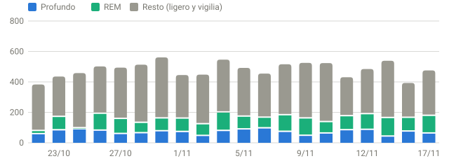

# Garmin Recovery · Cierre matinal

Sábado, 28 de noviembre de 2026 · 11:42 · `GR-2026-11-28-1142-3e5635`

```cards
Decisión|Prioriza recuperar|RPE máx. 4|red
Recuperación oficial|48/100|confianza high|red
HRV|51 ms|-4 % vs mediana|green
Sueño|1 h 11 min|puntuación 22|unavailable
FC en reposo|55 lpm|mediana 55|unavailable
Carga 7 días|10 sesiones|sRPE 1903|unavailable
```

## Resumen ejecutivo

- 🟢 **Certificación:** ciclo 2026-11-28-0830 validado; 4 de 4 procesos finalizados correctamente.
- 🔴 **Recuperación:** 48/100 (oficial, confianza high). Híbrido: 15/100. **Decisión: Prioriza recuperar**, RPE máx. 4.
- 🌙 **Sueño:** 1 h 11 min, puntuación 22/100.
- ❤️ **Principal alerta:** HRV 51 ms, 3,8 % por debajo de tu mediana de 28 días; FC nocturna 65,6 lpm (4,3 sobre la mediana).
- 🏋️ **Qué hacer:** Movilidad, zona 2 suave (30–40 min) o descanso. Sin cargas máximas ni WOD intensos.

## 1. Certificación y calidad

| Comprobación | Resultado |
|---|---|
| Ciclo | 2026-11-28-0830 |
| Estado del certificado | READY |
| Sync | Correcto |
| Heart Rate | Correcto |
| Advanced Analytics | Correcto |
| CrossFit Insights | Correcto (publicando en este mismo ciclo) |
| Certificado generado | 08:32:11 |
| Instantánea inmutable (SHA-256) | Disponible |
| Confianza de recuperación | high |
| Calidad fisiológica de los datos | 100/100 (good) |

La calidad describe los datos disponibles, no el software. Incluye datos de un Sync posterior al ciclo (11:41), sin certificado de franja propio: sesiones, FC diurna y Body Battery pueden ser más recientes que el certificado.

### Fuentes de datos

| Fuente | Último dato | Estado |
|---|---|---|
| Intervals.icu · bienestar (HRV, FC reposo, sueño) | 2026-11-28 | 🟢 al día |
| Intervals.icu · actividades | 2026-11-27 | 🟢 descarga correcta (2026-11-28) |
| Garmin · FC diurna y nocturna | 2026-11-28 | 🟢 al día |
| Garmin · estrés | 2026-11-28 | 🟢 al día |
| Garmin · Body Battery | 2026-11-28 | 🟢 al día |
| Garmin · Training Readiness y tiempo de recuperación | 2026-11-28 | 🟢 al día |
| Garmin · sueño | 2026-11-28 | 🟢 al día |

_Un retraso de un día es normal a primera hora; se avisa por GitHub si Intervals falla tres veces seguidas._

## 2. Recuperación fisiológica

| Indicador | Hoy | Mediana fusionada 28 días | Días |
|---|---|---|---|
| HRV | 51 ms | 53 ms | 28 |
| FC en reposo | 55 lpm | 55 lpm | 28 |
| FC nocturna | 65,6 lpm | 61,2 lpm | 28 |
| Duración del sueño | 1 h 11 min | 7 h 23 min | 28 |
| Puntuación de sueño | 22 | 80 | 28 |

Las referencias son medianas históricas, no objetivos.

La HRV está 4 % por debajo de su mediana; la FC en reposo coincide con su mediana.


### Modelos de recuperación

| Modelo | Resultado | Papel |
|---|---|---|
| Recuperación oficial | 🔴 48/100 | oficial |
| Híbrido Garmin + local | 🔴 15/100 | salvaguarda |
| Modelo experimental | — | sombra |
| Modelo de compatibilidad | 🔴 23/100 | compatibilidad |
| Garmin Training Readiness | ⚪ 3/100 | contexto |
| Tiempo de recuperación Garmin | 76,0 h | contexto |
| Índice personal experimental | 2/100 | provisional |

_Divergencia entre modelos:_ El modelo experimental (pendiente) es más permisivo que la decisión (rojo); se aplica la más conservadora.

**Qué ha cambiado desde ayer**

Modelo experimental: 79 → 62 (green → yellow). Cambios notables frente a ayer:

- HRV: 71 → 51 ms (desfavorable)
- FC en reposo: 52 → 55 lpm (desfavorable)
- FC nocturna: 56,7 → 65,6 lpm (desfavorable)
- Sueño: 8,0 → 1,2 h (desfavorable)
- Puntuación de sueño: 81 → 22 (desfavorable)

Son diferencias observadas, no causas.

Las puntuaciones no son equivalentes entre sí. La decisión es la zona más conservadora entre el modelo oficial, el híbrido y el experimental; un rojo prevalece. El índice personal es provisional y no es una medida clínica.

## 3. Sueño y recuperación nocturna

Episodio confirmado: 28 de noviembre de 2026, 01:36 → 28 de noviembre de 2026, 04:15.

| Dato | Valor |
|---|---|
| Duración efectiva | 1 h 11 min |
| Puntuación | 22/100 |
| Sueño profundo | 41 min |
| Sueño REM | 0 min |

El REM representa un 0 % y el sueño profundo un 58 % del episodio.




**Necesidad y deuda de sueño**

| Componente | Horas |
|---|---|
| Base configurada | 7,5 |
| Recargo por carga de ayer | +0,3 |
| Recargo por deuda de las últimas 3 noches | +1,0 |
| Siesta de hoy | −0,0 |
| **Necesidad estimada esta noche** | **8,8 h** |
| Deuda de las últimas 3 noches (siestas descontadas) | 7,4 h |
| Deuda de 7 noches (siestas descontadas) | 9,6 h |

Es una estimación heurística, no validada; los recargos tienen tope y no sustituyen tu percepción. Solo cuentan siestas registradas por Garmin. El modelo experimental usa solo las últimas 3 noches y no descuenta siestas: por eso su deuda (7,4 h) puede ser mayor que la de 3 noches de esta tabla.

No se incorporan siestas no confirmadas.

## 4. Frecuencia cardíaca y tendencias

| Ventana | FC diurna | FC nocturna |
|---|---|---|
| Hoy* | 70,5 lpm | 65,6 lpm |
| 3 días | 76,8 lpm | 60,2 lpm |
| 7 días | 73,8 lpm | 57,8 lpm |
| 28 días | 77,8 lpm | 61,0 lpm |

\* La FC diurna de hoy es de un día parcial: no es FC en reposo.

Cobertura histórica fusionada (días con dato de 28):

| Indicador | Datos disponibles |
|---|---|
| HRV | 28/28 días |
| Sueño | 28/28 días |
| Puntuación de sueño | 28/28 días |
| FC en reposo | 28/28 días |


### Estrés y Body Battery

- Estrés medio: 36, máximo 94.
- Body Battery: último valor 15/100, medido a las 07:21 (hace 4 h 21 min: no es una medición nueva).
- Recuperación de FC a 1 min tras el ejercicio: 7 observaciones recientes, mediana 24,0 lpm.

**Diario de correlaciones (HRV del día siguiente)**

| Factor | Con | Sin | HRV siguiente día (con / sin) | Diferencia |
|---|---|---|---|---|
| Día anterior con sesión registrada | 34 | 30 | 51,0 / 59,1 ms | **-8,1 ms** |
| Día anterior con turno de noche (TN) | 12 | 11 | 50,9 / 67,1 ms | **-16,2 ms** |
| Noche anterior de menos de 6,5 h | 20 | 43 | 54,8 / 54,7 ms | 0,0 ms (pequeña) |

Son asociaciones en tus propios datos de los últimos 90 días, sin causalidad ni prueba estadística; con pocos días pueden ser casualidad.

**Calibración de la zona del día**

HRV de la noche siguiente frente a tu mediana de 90 días (53,5 ms):

| Zona del día | Días | HRV siguiente noche vs mediana |
|---|---|---|
| 🟢 Verde | 11 | -1,6 ms |
| 🟡 Amarillo | 11 | +0,9 ms |
| 🔴 Rojo | 20 | +2,9 ms |

Solo descriptivo: sirve para ver si la zona se corresponde con tu recuperación posterior; no cambia umbrales.

## 5. Rendimiento CrossFit

Última actividad registrada: 27 nov. Descansos confirmados por ti: 3 en 7 días y 9 en 28. Un día sin registro y sin confirmar no demuestra que fuera de descanso.

Contraste Garmin ↔ Intervals: las 10 actividades de Garmin de los últimos 7 días constan también en Intervals.


### Últimos 7 días

| Métrica | Resultado |
|---|---|
| Sesiones registradas | 10 |
| Días con actividad | 4 |
| RPE medio | 7,17 |
| Sesiones de RPE ≥ 8 | 3 |
| Minutos grabados (Garmin) | 322,3 min |
| sRPE por duración registrada | 1903 |
| TRIMP | 321,4 |
| Carga de actividades (Intervals) | 192 |
| Volumen externo mínimo verificado | 16.535 kg |

El volumen es un mínimo cuantificable, no un tonelaje comparable entre barra, mancuernas y máquinas.

Últimos 28 días: 40 sesiones, RPE medio 7,21, TRIMP 1155,1 y 1330,1 minutos grabados.

### sRPE diario registrado

```
22 nov —             descanso
23 nov ████          320
24 nov ██            131
25 nov ████████████  1030
26 nov —             descanso
27 nov █████         422
28 nov —             descanso
```

El 25 nov concentra la mayor carga sRPE de la semana. La relación con las señales de recuperación es descriptiva, no causal.

Monotonía 0,73 · strain 1382 (descriptores de contexto, sin umbral médico).

### Carrera

| Fecha | km | Tiempo | Ritmo (min/km) | FC media / máx. | m/latido | Cadencia (ppm) | Desnivel + | RPE |
|---|--:|--:|--:|--:|--:|--:|--:|--:|
| 28/10 | 8,02 | 41:13 | 5:09 | 157 / 177 | 1,24 | 163 | 54 m | 7,0 |
| 04/10 | 8,09 | 42:58 | 5:19 | 154 / 173 | 1,22 | 164 | 69 m | 8,0 |

Frente a la del 04/10 (8,09 km): 10 s/km más rápido, FC media +3 lpm; eficiencia parecida.

Metros por latido = velocidad (m/min) ÷ FC media. Comparaciones descriptivas entre carreras de distancia parecida (±25 %); el calor, el desnivel, el cansancio previo y el sensor también influyen.

## 6. Fuerza, halterofilia y metcons

- **27 nov — Fuerza - pecho: press banca y press inclinado con mancuernas** · RPE 5 · volumen de barra cuantificado 3840 kg · FC media 110 / máx. 140 lpm · TRIMP 12
  Press banca: 20x20 (barra vacía), 20x40, 20x60, 8x80, 6x80, 12x60 kg; volumen 3.840 kg sin barra vacía (4.240 con ella). Press inclinado con mancuernas (kg por mancuerna): 12x25, 10x27,5, 8x30; volumen 1.630 kg. RPE 5 de todo el bloque. Garmin 21,2 min.
- **27 nov — WOD For Time 20-16-12-8 - thruster / toes to bar** · RPE 7,5 · FC media 157 / máx. 184 lpm · TRIMP 17 · ⚠️ RPE bajo para tu FC: la FC fue alta para el esfuerzo que marcaste
  For Time 20-16-12-8 (TC 10'): thrusters con 40 kg + toes to bar. Terminado en 8:10. Totales: 56 thrusters (2.240 kg), 56 toes to bar. RPE 7,5. Garmin 8,9 min.
  Para comparar: parecido el 8 oct (AMRAP, RPE 8, 2 rondas · 114 reps en total). Orientativo.
- **27 nov — Fuerza - front squat (+ calentamiento)** · RPE 7 · volumen de barra cuantificado 2585 kg · FC media 119 / máx. 170 lpm · TRIMP 27
  Calentamiento + front squat cada 1'30": series previas 3x barra vacía, 3x40, 3x60, 3x80 kg; trabajo 5x90, 5x100, 4x110, 4x115, 3x120, 3x125 kg. Volumen de trabajo 2.585 kg. RPE 7. Garmin 35,6 min.
- **25 nov — Fuerza - pierna: sentadilla trasera, sentadilla péndulo, extensión de cuádriceps, curl fe…** · RPE 6 · volumen de barra cuantificado 6290 kg · FC media 118 / máx. 150 lpm · TRIMP 53
  Sentadilla trasera: 12x20 (barra vacía), 12x40, 12x60, 10x80, 10x100, 8x120, 8x130, 6x140, 3x150 kg; volumen 6.290 kg sin barra vacía (6.530 con ella). Sentadilla péndulo: 10x40, 10x50, 8x60, 8x70 kg. Extensión de cuádriceps unilateral: 15x20, 15x25, 15x30 kg por pierna. Curl femoral tumbado: 12x60, 2x8x67, 8x74 kg. Curl femoral de pie unilateral: 3x8x30 kg por pierna. Sit-ups 4x25. RPE 6 de toda la sesión. Garmin 7…
- **25 nov — Halterofilia - complex clean pull + hang power clean + power clean / power clean 3x3 / pu…** · RPE 7 · volumen de barra cuantificado 2480 kg · FC media 122 / máx. 153 lpm · TRIMP 45
  Complex 3x1 cada 1'30" (clean pull + hang power clean + power clean): calentamiento con barra vacía, 40, 50 y 60 kg; trabajo 65, 70 y 75 kg (RPE 6). Power clean 3x3 cada 2' (10" entre reps): 75, 80 y 90 kg (RPE 6,5). Push press 3x5 cada 2': calentamiento en series de 3 con barra vacía, 40, 50, 60 y 65 kg; trabajo 70, 75 y 78 kg (RPE 7,5). Volumen de trabajo 2.480 kg. RPE de sesión 7 (media aproximada). Garmin 54,4 m…
- **25 nov — Calentamiento - WOD** · FC media 144 / máx. 187 lpm · TRIMP 56
  Calentamiento del WOD. Sin RPE: no puntuado por decisión del atleta. Tramo 0:00–10:00 de la actividad (10 min).
- **25 nov — WOD EMOM 28' - max cal SkiErg-remo / devil press / burpee box jump** · RPE 8
  EMOM 28' (7 rondas de 4 min): M1 máx. calorías en 50" alternando SkiErg y remo (empieza SkiErg); M2 6 devil press con dos mancuernas de 22,5 kg; M3 6 burpee box jumps a 60 cm (pizarra 5–10); M4 descanso. Calorías por ronda: 17, 17, 14, 15, 12, 14, 12 = 101 (SkiErg 55, remo 46). Totales: 42 devil press (1.890 kg), 42 burpee box jumps. RPE 8. Tramo 10:00–38:00 de la actividad (28 min).
- **24 nov — WOD 3 RFT (TC 14') - remo / wall ball / bar muscle-up** · RPE 9 · FC media 160 / máx. 179 lpm · TRIMP 31
  3 Rounds For Time, TC 14': 500 m remo (en lugar de 400 m carrera) + 30 wall balls 9 kg + 9 bar muscle-ups. Resultado: 2 rondas + 166 m de remo al llegar al límite. Bar muscle-ups: ronda 1 en 4+3+2, ronda 2 en 3+3+1+1+1. Totales: 1.166 m remo, 60 wall balls (540 kg), 18 bar muscle-ups. RPE 9. Garmin 14,6 min.
  Para comparar: parecido el 27 oct (AMRAP, RPE 8, 6 rondas + 200 m + 10 reps · 136 reps en total); parecido el 13 oct (AMRAP, RPE 9, 5 rondas + 5 reps · 155 reps en total). Orientativo.
- **24 nov — Técnica - comba (single, crossover, DU, DU crossover) + bar muscle-up 2x2 (+ calentamient…** · FC media 124 / máx. 176 lpm · TRIMP 31
  Calentamiento + técnica de comba: single unders, crossover single under, double unders y double-under crossover. Después calentamiento de bar muscle-up y 2x2 bar muscle-ups. Sin RPE: sesión no puntuada por decisión del atleta. Garmin 34,6 min.
- **23 nov — WOD AMRAP 12' - double unders / one arm devil press / push press DB** · RPE 8 · FC media 155 / máx. 187 lpm · TRIMP 24
  AMRAP 12': 50 double unders + 6 one arm devil press (alternando) + 18 push press con una mancuerna de 22,5 kg (repartido entre brazos). Resultado 3 rondas + 66 (50 DU + 6 devil press + 10 push press) = 288 repeticiones. Totales: 200 DU, 24 devil press (540 kg), 64 push press (1.440 kg). RPE 8. Garmin 13,2 min (parado después del final).
- **23 nov — Halterofilia - power snatch 5x5 (+ calentamiento)** · RPE 7 · volumen de barra cuantificado 1340 kg · FC media 122 / máx. 171 lpm · TRIMP 24
  Calentamiento + power snatch cada 1'30": series previas 4x3 con barra vacía, 30, 35 y 40 kg (sin RPE); 5x5 con 45, 50, 55, 58 y 60 kg. Volumen de trabajo 1.340 kg. RPE 7. Garmin 30,6 min.

RPE frente a FC: se marcan las sesiones cuyo esfuerzo relativo, ln(sRPE / carga de FC) frente a tu historial del mismo tipo, se aleja ±1,5 desviaciones robustas. Es descriptivo y no cambia la decisión del día.

**Carga de fuerza por patrón**

| Patrón | 7 d: bloques · series | 7 d: barra (kg) | 28 d: bloques · series | 28 d: barra (kg) |
|---|---|---|---|---|
| Bíceps (aislamiento) | — | — | 2 · 8 | — |
| Pecho (aislamiento) | — | — | 2 · 8 | — |
| Core | 1 · 4 | — | 3 · 12 | — |
| Bisagra de cadera | — | — | 3 · 18 | 8.800 |
| Tirón horizontal | — | — | 2 · 8 | — |
| Empuje horizontal | 2 · 8 | 3.840 | 8 · 39 | 15.640 |
| Flexión de rodilla | 2 · 7 | — | 5 · 23 | — |
| Halterofilia | 3 · 11 | 2.705 | 11 · 70 | 9.291 |
| Otros | 1 · 3 | — | 2 · 7 | — |
| Sentadilla | 3 · 18 | 8.875 | 10 · 56 | 21.057 |
| Tirón vertical | — | — | 3 · 19 | — |
| Empuje vertical | 1 · 3 | 1.115 | 1 · 3 | 1.115 |

Solo series declaradas; «+» indica bloques sin número de series. El volumen en kg cuenta únicamente barra con carga total y volumen completo; no se suma entre equipos. Un patrón sin registros no demuestra que no se entrenara.

**Progresión por ejercicio (barra)**

| Ejercicio | Semana | Mejor serie | 1RM mínimo | Sesiones |
|---|---|---|---|---|
| 3-position squat snatch | 2026-S47 | 48 kg × 3 | 52,8 kg | 1 |
| clean pull | 2026-S45 | 90 kg × 1 | 90 kg | 1 |
| clean pull + hang power clean + power clean | 2026-S48 | 75 kg × 3 | 82,5 kg | 1 |
| front squat | 2026-S44 | 70 kg × 1 | 70 kg | 1 |
| front squat | 2026-S48 | 125 kg × 3 | 137,5 kg | 1 |
| hang power clean | 2026-S45 | 90 kg × 1 | 90 kg | 1 |
| peso muerto | 2026-S41 | 170 kg × 5 | 198,3 kg | 1 |
| peso muerto | 2026-S46 | 180 kg × 3 | 198 kg | 1 |
| power clean | 2026-S45 | 90 kg × 1 | 90 kg | 1 |
| power clean | 2026-S48 | 90 kg × 3 | 99 kg | 1 |
| power clean + squat clean (complex 1+1) | 2026-S43 | 90 kg × 1 | 90 kg | 1 |
| power snatch | 2026-S46 | 60 kg × 5 | 70 kg | 1 |
| power snatch | 2026-S48 | 60 kg × 5 | 70 kg | 1 |
| press banca | 2026-S44 | 90 kg × 6 | 108 kg | 1 |
| press banca | 2026-S45 | 90 kg × 6 | 108 kg | 1 |
| press banca | 2026-S46 | 90 kg × 6 | 108 kg | 1 |
| press banca | 2026-S48 | 80 kg × 8 | 101,3 kg | 1 |
| push press | 2026-S48 | 78 kg × 5 | 91 kg | 1 |
| sentadilla con safety bar | 2026-S45 | 133 kg × 8 | 168,5 kg | 1 |
| sentadilla trasera | 2026-S41 | 170 kg × 2 | 181,3 kg | 2 |
| sentadilla trasera | 2026-S42 | 185 kg × 1 | 185 kg | 1 |
| sentadilla trasera | 2026-S46 | 140 kg × 6 | 168 kg | 1 |
| sentadilla trasera | 2026-S48 | 140 kg × 6 | 168 kg | 1 |
| split jerk | 2026-S44 | 100 kg × 1 | 100 kg | 1 |
| split jerk | 2026-S45 | 103 kg × 1 | 103 kg | 1 |
| squat clean | 2026-S43 | 110 kg × 1 | 110 kg | 1 |
| squat clean | 2026-S44 | 100 kg × 1 | 100 kg | 1 |
| squat clean | 2026-S45 | 103 kg × 1 | 103 kg | 1 |
| squat snatch | 2026-S42 | 68 kg × 1 | 68 kg | 1 |
| squat snatch | 2026-S44 | 75 kg × 1 | 75 kg | 1 |
| squat snatch | 2026-S47 | 63 kg × 3 | 69,3 kg | 1 |

Diferencias entre las dos últimas semanas con datos: front squat: 1RM mínimo +67,5 kg entre 2026-S44 y 2026-S48; peso muerto: 1RM mínimo -0,3 kg entre 2026-S41 y 2026-S46; power clean: 1RM mínimo +9 kg entre 2026-S45 y 2026-S48; power snatch: 1RM mínimo 0 kg entre 2026-S46 y 2026-S48; press banca: 1RM mínimo -6,7 kg entre 2026-S46 y 2026-S48; sentadilla trasera: 1RM mínimo 0 kg entre 2026-S46 y 2026-S48; split jerk: 1RM mínimo +3 kg entre 2026-S44 y 2026-S45; squat clean: 1RM mínimo +3 kg entre 2026-S44 y 2026-S45; squat snatch: 1RM mínimo -5,7 kg entre 2026-S44 y 2026-S47.

Solo barra con carga total. El 1RM es un límite inferior (Epley sin RIR) y no se deduce del RPE; las semanas sin registro no implican que no se entrenara ese ejercicio.

No se atribuyen desgloses no confirmados ni se comparan récords no equivalentes; se conserva la diferencia entre cronómetro oficial y reloj.

## 7. Balance y orientación

Turno: hoy libre tras la noche, mañana libre.
- Señales adversas: FC nocturna elevada; Training Readiness de Garmin bajo (3/100); Body Battery bajo (15/100).

### Recomendaciones

1. **Prioriza recuperar** — Movilidad, zona 2 suave (30–40 min) o descanso. Sin cargas máximas ni WOD intensos.
2. Ajusta la sesión de hoy con las reglas por tipo del informe del ciclo (`app/informe.md`).
3. Registra sensaciones y fatiga percibida en Intervals: ayudan a contextualizar la recuperación tras varios entrenamientos exigentes.

## 8. Análisis de mejora física y recuperación

Reglas explícitas sobre tus últimos 28 días, sin IA. Son criterios generales de entrenamiento y descanso, no un diagnóstico médico. Cuando los datos no bastan, lo dice y no concluye.

### Prioridades

| # | Área | Qué muestran tus datos | Qué hacer |
|---|---|---|---|
| 1 | Sueño | Media de 7 noches: 6,5 h (necesidad configurada 7,5 h); 2 de 7 noches más de media hora por debajo; deuda acumulada 9,6 h (cuenta también el sueño diurno tras turno y descuenta las siestas registradas). | Recupera la deuda poco a poco: 30–45 min más cada noche, no una sola noche larga. |
| 2 | Distribución de la intensidad | 10 de 29 sesiones con RPE registrado fueron de RPE ≥ 8 (34 %); 5 veces hubo dos días duros seguidos. | Intercala sesiones de RPE 5–6 entre las duras y deja ≥ 48 h entre dos esfuerzos máximos. |
| 3 | Registro de sensaciones | Sensaciones (fatiga, agujetas, estrés, ánimo, motivación) registradas en 0 de los últimos 14 días. | Apunta cada mañana en Intervals 1–5 de fatiga, agujetas y ánimo (20 segundos). |

### Detalle por área

- ✅ **HRV.** HRV media de los últimos 7 días: 63,5 ms frente a tu base de 53 ms (+20 %); tu rango normal es 47,7–58,9 ms. Es la misma media (logarítmica) que usa la puntuación. Tendencia por encima de tu referencia: buena señal de recuperación.
- ✅ **FC en reposo.** FC en reposo de los últimos 7 días: 52,3 lpm frente a 56,0 de referencia (-3,7 lpm). En línea con tu referencia.
- 🔴 **Sueño.** Media de 7 noches: 6,5 h (necesidad configurada 7,5 h); 2 de 7 noches más de media hora por debajo; deuda acumulada 9,6 h (cuenta también el sueño diurno tras turno y descuenta las siestas registradas). El sueño es el principal factor de recuperación y de adaptación al entrenamiento.
- ✅ **Regularidad del sueño.** Hora de acostarte (mediana 00:56) con una variación típica de ±32 min en 14 noches; 3 turnos TN en los últimos 14 días. Un horario irregular reduce la calidad del sueño; con turnos rotativos es difícil, pero el ancla (hora de despertar o de la siesta) ayuda.
- ⚠️ **Distribución de la intensidad.** 10 de 29 sesiones con RPE registrado fueron de RPE ≥ 8 (34 %); 5 veces hubo dos días duros seguidos. Una parte alta de sesiones muy duras, sobre todo en días consecutivos, deja poco margen de recuperación y limita la mejora.
- ✅ **Respuesta a las sesiones duras.** HRV la mañana siguiente: 57 ms tras sesión de RPE ≥ 8 (n=10) frente a 48 ms tras las demás (n=7); diferencia +9 ms. Es una relación descriptiva con pocos días, no demuestra causa.
- ✅ **Fuerza.** Mejor valor registrado en 28 días: peso muerto 198 kg; sentadilla trasera 185 kg; sentadilla con safety bar 168 kg. Es un mínimo estimado (Epley sin RIR) o la carga máxima declarada: solo se comparan series con las mismas repeticiones.
- ⚠️ **Registro de sensaciones.** Sensaciones (fatiga, agujetas, estrés, ánimo, motivación) registradas en 0 de los últimos 14 días. Las sensaciones son el contraste más barato frente a los números del reloj: sin ellas, la app solo ve la parte objetiva. Además: 0 sesiones de 28 días sin RPE y HRV con dato en 14 de 14 días.

### Constancia semanal (últimas 4 semanas)

| Semana (lunes) | Sesiones | Días con actividad | sRPE |
|---|---|---|---|
| 02/11 | 9 | 4 | 1114 |
| 09/11 | 12 | 5 | 2140 |
| 16/11 | 9 | 4 | 889 |
| 23/11 | 10 | 4 | 1903 |

_La semana en curso está incompleta; compara solo semanas completas._

### Semana a semana

Última semana completa (lunes 16/11) frente a la anterior (lunes 09/11). La semana en curso (6 de 7 días, hoy incluido) se muestra aparte y no se compara. Son diferencias descriptivas, no explican causas.

| Métrica | Sem. 09/11 | Sem. 16/11 | Cambio | En curso | 4 semanas |
|---|---|---|---|---|---|
| HRV nocturna | 52 (7 d) | 63 (7 d) | ✅ +11 ms (+21 %) | 64 (6 d) | `▁▂▇█` |
| FC en reposo | 56,0 (7 d) | 52,1 (7 d) | ✅ −3,9 lpm | 52,7 (6 d) | `█▆▁▂` |
| Sueño | 7,2 (7 d) | 6,9 (7 d) | ≈ −0,3 h | 6,0 (6 d) | `█▇▆▁` |
| Puntuación de sueño | 72 (7 d) | 71 (7 d) | ≈ −1 | 70 (6 d) | `█▆▅▁` |
| Sesiones | 12 | 9 | −3 | 10 |  |
| Días con actividad | 5 | 4 | −1 | 4 |  |
| sRPE total | 2140 | 889 | −1251 (−58 %) | 1903 | `▂█▁▇` |

_Barras: ▁ valor más bajo, █ más alto de las últimas 4 semanas; «·» sin datos suficientes._

### Plan orientativo de 7 días

| Día | Turno | Sesión sugerida | Motivo |
|---|---|---|---|
| sáb 28/11 | tras TN | 🟢 Suave / movilidad | la decisión de hoy limita la intensidad |
| dom 29/11 | libre | 🟡 Moderada | día libre; ya hay 3 sesiones duras en los últimos 7 días |
| lun 30/11 | libre | 🔥 Exigente | día libre con margen para una sesión exigente |
| mar 01/12 | MT | 🟢 Suave / movilidad | turno largo: movilidad o descanso |
| mié 02/12 | TN | 🟡 Moderada | TN por la tarde: si entrenas, por la mañana y moderado |
| jue 03/12 | tras TN | 🛌 Descanso | día posterior a una TN: prioriza dormir |
| vie 04/12 | libre | 🔥 Exigente | día libre con margen para una sesión exigente |

Plan orientativo por reglas (máx. 3 sesiones con RPE ≥ 8 por semana, separadas ≥ 48 h, solo en días libres). Se recalcula en cada informe y la decisión del día manda sobre él.

### Reglas para los próximos 7 días

1. **Hoy:** respeta la decisión del día (Prioriza recuperar, RPE máx. 4).
2. **Esfuerzos máximos:** como mucho 2–3 sesiones de RPE ≥ 8 en la semana y separadas ≥ 48 h.
3. **Sueño:** suma 30–45 min cada noche en lugar de una sola noche larga; antes de un turno de noche, siesta corta.
4. **Registro:** fatiga, agujetas y ánimo cada mañana en Intervals; RPE de cada sesión el mismo día.
5. **Reevaluación:** dentro de 7 días compara tu HRV media y tu FC en reposo con la referencia de 28 días.

_Los puntos 2 y 3 son criterios generales de entrenamiento y descanso, no una prescripción personalizada._

## Conclusión

Datos suficientes para evaluar la recuperación de hoy: la decisión es **🔴 Prioriza recuperar**. No es un diagnóstico médico. Que el informe esté publicado no prueba que se haya leído una notificación.

---

Traza: cierre matinal · ciclo 2026-11-28-0830 · generado 28/11/2026 11:42 Europe/Madrid · certificado READY · sync_run_id 46121523637.
