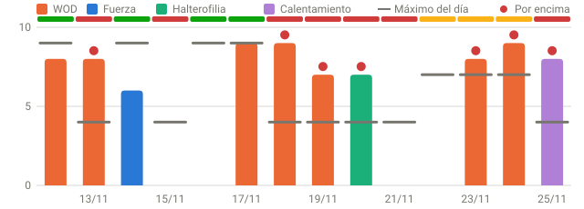
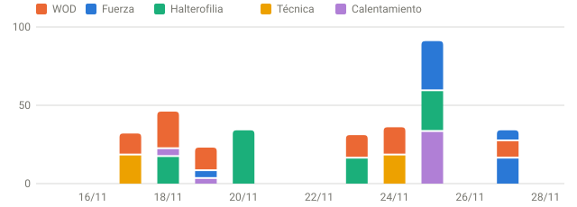
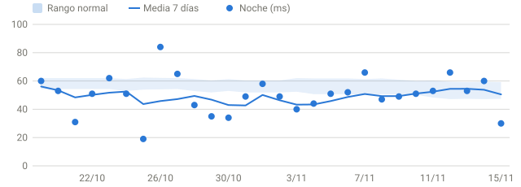
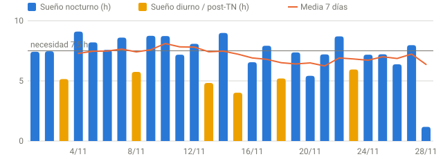

# Resumen semanal · 22/11–28/11

_Semana móvil que termina hoy, comparada con los 7 días anteriores. Fuente: `app/readiness_v3.json` (informe `GR-2026-11-28-1247-3be062`)._

## En una frase

- 10 sesiones (+1); HRV de 7 días por encima de tu rango normal; 5 de 7 noches con datos por debajo de 7,5 h de sueño; 4 de 4 días comprobados por encima del RPE máximo.
- Decisión registrada en 7/7 días: ámbar 3 · rojo 4.

## Gráficas de la semana

_Barras: RPE de la sesión más dura de cada día; raya gris: máximo que permitía la decisión; punto rojo: por encima._

## Entrenamiento

| | Esta semana | Semana previa |
|---|--:|--:|
| Sesiones | 10 | 9 |
| Minutos | 322 | 222 |
| Carga (Intervals) | 192 | 135 |
| sRPE (RPE × min) | 1903 | 889 |

Monotonía 0,73 · strain 1382 · ACWR 1,26 · RPE registrado en 9/10 sesiones.

**Días por encima del RPE máximo de la decisión:** 23/11 (RPE 8,0 > 7), 24/11 (RPE 9,0 > 7), 25/11 (RPE 8,0 > 4), 27/11 (RPE 7,5 > 4).

## Recuperación

| | Esta semana | Semana previa |
|---|--:|--:|
| HRV media | 64,4 ms | 57,3 ms |
| FC en reposo media | 52,3 lpm | 53,3 lpm |
| Sueño medio | 6,37 h | 6,24 h |

HRV de 7 días hoy: 63,5 ms (rango normal 47,7–58,9 ms). Turnos: TN, MT, TN.

## Fuerza de la semana

| Fecha | Ejercicio | Carga máx. declarada | Mejor serie | 1RM mín. | Series |
|---|---|--:|--:|--:|--:|
| 23/11 | power snatch | 60,0 kg | 60 × 5 | 70,0 kg | 5/5 |
| 25/11 | sentadilla trasera | 150,0 kg | 140 × 6 | 168,0 kg | 8/8 |
| 25/11 | sentadilla péndulo | 70,0 kg | — | — | 4/4 |
| 25/11 | extensión de cuádriceps sentado unilateral | 30,0 kg | — | — | 3/3 |
| 25/11 | curl femoral tumbado | 74,0 kg | — | — | 4/4 |
| 25/11 | curl femoral de pie unilateral | 30,0 kg | — | — | 3/3 |
| 25/11 | clean pull + hang power clean + power clean | 75,0 kg | 75 × 3 | 82,5 kg | 3/3 |
| 25/11 | power clean | 90,0 kg | 90 × 3 | 99,0 kg | 3/3 |
| 25/11 | push press | 78,0 kg | 78 × 5 | 91,0 kg | 3/3 |
| 27/11 | press banca | 80,0 kg | 80 × 8 | 101,3 kg | 5/5 |
| 27/11 | press inclinado con mancuernas | 60,0 kg | 60 × 8 | 76,0 kg | 3/3 |
| 27/11 | front squat | 125,0 kg | 125 × 3 | 137,5 kg | 6/6 |

_1RM mín. = Epley con la mejor serie (hasta 10 repeticiones): tu 1RM real es igual o mayor. Solo es comparable con el mismo ejercicio e implemento._

## Puntualidad de los informes

**18 de 19** franjas con el informe listo antes de que ChatGPT lo lea (09:05, 17:10 y 23:10).

| Fecha | Franja | Sync | Informe listo | Margen |
|---|---|--:|--:|--:|
| 22/11 | 08:30 | 15:22 | 15:23 | -379 min ⚠️ tarde |
| 22/11 | 16:45 | 16:46 | 16:47 | 23 min ✓ |
| 22/11 | 22:45 | 22:46 | 22:47 | 23 min ✓ |
| 23/11 | 08:30 | 08:31 | 08:31 | 33 min ✓ |
| 23/11 | 16:45 | 16:46 | 16:47 | 23 min ✓ |
| 23/11 | 22:45 | 22:46 | 22:47 | 23 min ✓ |
| 24/11 | 08:30 | 08:31 | 08:32 | 33 min ✓ |
| 24/11 | 16:45 | 16:46 | 16:47 | 22 min ✓ |
| 24/11 | 22:45 | 22:46 | 22:47 | 23 min ✓ |
| 25/11 | 08:30 | 08:31 | 08:32 | 33 min ✓ |
| 25/11 | 16:45 | 16:52 | 16:53 | 17 min ✓ |
| 25/11 | 22:45 | 22:46 | 22:47 | 23 min ✓ |
| 26/11 | 08:30 | 08:31 | 08:32 | 33 min ✓ |
| 26/11 | 16:45 | 16:46 | 16:47 | 23 min ✓ |
| 26/11 | 22:45 | 22:46 | 22:47 | 23 min ✓ |
| 27/11 | 08:30 | 08:31 | 08:32 | 33 min ✓ |
| 27/11 | 16:45 | 16:46 | 16:47 | 23 min ✓ |
| 27/11 | 22:45 | 22:46 | 22:47 | 23 min ✓ |
| 28/11 | 08:30 | 08:31 | 08:32 | 33 min ✓ |

## Calidad de los datos

- Noches con HRV: 7/7 · con sueño: 7/7.
- Sesiones con RPE: 9/10.

## Validación de modelos

El v3 todavía no muestra relación clara con el esfuerzo: se mantiene el v2.

_No es un diagnóstico médico._
