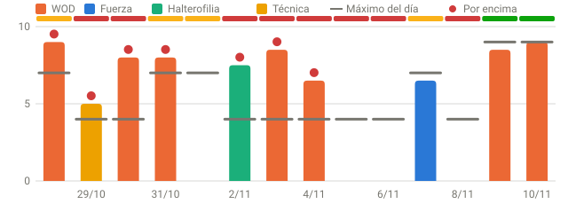
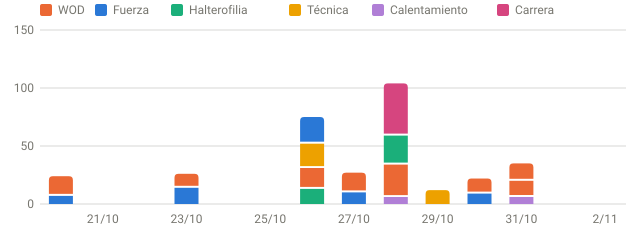
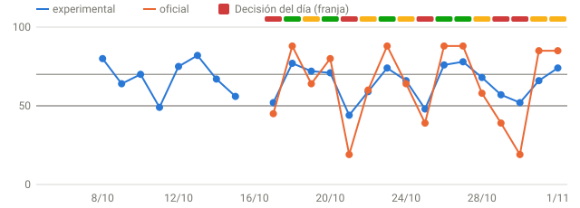
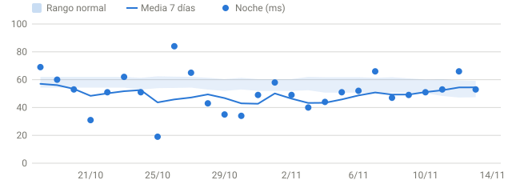
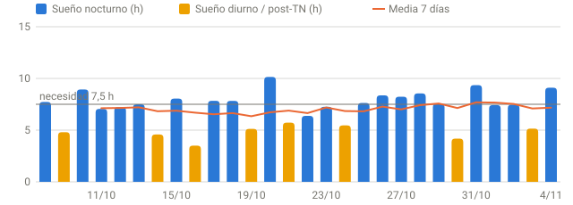

# Resumen semanal · 31/10–06/11

_Semana móvil que termina hoy, comparada con los 7 días anteriores. Fuente: `app/readiness_v3.json` (informe `GR-2026-11-06-0833-6b2c0c`)._

## En una frase

- 11 sesiones (−2); HRV de 7 días por debajo de tu rango normal; 3 de 7 noches con datos por debajo de 7,5 h de sueño; 4 de 4 días comprobados por encima del RPE máximo.
- Decisión registrada en 7/7 días: ámbar 2 · rojo 5.

## Gráficas de la semana

_Barras: RPE de la sesión más dura de cada día; raya gris: máximo que permitía la decisión; punto rojo: por encima._

## Entrenamiento

| | Esta semana | Semana previa |
|---|--:|--:|
| Sesiones | 11 | 13 |
| Minutos | 380 | 416 |
| Carga (Intervals) | 187 | 240 |
| sRPE (RPE × min) | 938 | 1980 |

Monotonía 0,74 · strain 698 · ACWR 0,66 · RPE registrado en 6/11 sesiones.

**Días por encima del RPE máximo de la decisión:** 31/10 (RPE 8,0 > 7), 02/11 (RPE 7,5 > 4), 03/11 (RPE 8,5 > 4), 04/11 (RPE 6,5 > 4).

## Recuperación

| | Esta semana | Semana previa |
|---|--:|--:|
| HRV media | 49,0 ms | 47,3 ms |
| FC en reposo media | 58,0 lpm | 56,4 lpm |
| Sueño medio | 7,75 h | 7,14 h |

HRV de 7 días hoy: 48,7 ms (rango normal 50,7–61,8 ms). Turnos: MT, TN, MT.

## Fuerza de la semana

| Fecha | Ejercicio | Carga máx. declarada | Mejor serie | 1RM mín. | Series |
|---|---|--:|--:|--:|--:|
| 02/11 | clean pull | 90,0 kg | 90 × 1 | 90,0 kg | 8/8 |
| 02/11 | hang power clean | 90,0 kg | 90 × 1 | 90,0 kg | 8/8 |
| 02/11 | power clean | 90,0 kg | 90 × 1 | 90,0 kg | 8/8 |
| 04/11 | press banca | 90,0 kg | 90 × 6 | 108,0 kg | 7/7 |
| 04/11 | press banca inclinado con mancuernas | 67,0 kg | 67 × 8 | 84,9 kg | 4/4 |
| 04/11 | press superinclinado isolateral | 50,0 kg | — | — | 4/4 |
| 04/11 | aperturas en banco inclinado con mancuernas | 32,0 kg | 32 × 10 | 42,7 kg | 4/4 |
| 04/11 | curl de bíceps en máquina unilateral | 15,0 kg | — | — | 4/4 |
| 04/11 | squat clean | 103,0 kg | 103 × 1 | 103,0 kg | 10/10 |
| 04/11 | split jerk | 103,0 kg | 103 × 1 | 103,0 kg | 10/10 |

_1RM mín. = Epley con la mejor serie (hasta 10 repeticiones): tu 1RM real es igual o mayor. Solo es comparable con el mismo ejercicio e implemento._

## Puntualidad de los informes

**18 de 19** franjas con el informe listo antes de que ChatGPT lo lea (09:05, 17:10 y 23:10).

| Fecha | Franja | Sync | Informe listo | Margen |
|---|---|--:|--:|--:|
| 31/10 | 08:30 | 10:04 | 10:05 | -60 min ⚠️ tarde |
| 31/10 | 16:45 | 16:47 | 16:48 | 22 min ✓ |
| 31/10 | 22:45 | 22:47 | 22:48 | 22 min ✓ |
| 01/11 | 08:30 | 08:32 | 08:33 | 32 min ✓ |
| 01/11 | 16:45 | 16:47 | 16:48 | 22 min ✓ |
| 01/11 | 22:45 | 22:47 | 22:48 | 22 min ✓ |
| 02/11 | 08:30 | 08:32 | 08:33 | 31 min ✓ |
| 02/11 | 16:45 | 16:47 | 16:48 | 21 min ✓ |
| 02/11 | 22:45 | 22:47 | 22:48 | 21 min ✓ |
| 03/11 | 08:30 | 08:32 | 08:33 | 32 min ✓ |
| 03/11 | 16:45 | 16:47 | 16:48 | 22 min ✓ |
| 03/11 | 22:45 | 22:47 | 22:49 | 21 min ✓ |
| 04/11 | 08:30 | 08:32 | 08:33 | 32 min ✓ |
| 04/11 | 16:45 | 16:47 | 16:48 | 21 min ✓ |
| 04/11 | 22:45 | 22:47 | 22:48 | 22 min ✓ |
| 05/11 | 08:30 | 08:32 | 08:33 | 32 min ✓ |
| 05/11 | 16:45 | 16:47 | 16:48 | 22 min ✓ |
| 05/11 | 22:45 | 22:47 | 22:48 | 22 min ✓ |
| 06/11 | 08:30 | 08:32 | 08:33 | 32 min ✓ |

## Calidad de los datos

- Noches con HRV: 7/7 · con sueño: 7/7.
- Sesiones con RPE: 6/11.

## Validación de modelos

Acumulando datos: 9/20 días con entrenamiento, RPE y predicción de la mañana del v2 y del v3. Aún no hay veredicto.

_No es un diagnóstico médico._
