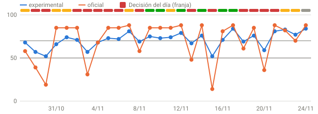

# Resumen semanal · 12/11–18/11

_Semana móvil que termina hoy, comparada con los 7 días anteriores. Fuente: `app/readiness_v3.json` (informe `GR-2026-11-18-2152-29fb27`)._

## En una frase

- 10 sesiones (+2); HRV de 7 días dentro de tu rango normal; 4 de 7 noches con datos por debajo de 7,5 h de sueño; 1 de 4 días comprobados por encima del RPE máximo.
- Decisión registrada en 7/7 días: verde 4 · rojo 3.

## Gráficas de la semana

_Barras: RPE de la sesión más dura de cada día; raya gris: máximo que permitía la decisión; punto rojo: por encima._

## Entrenamiento

| | Esta semana | Semana previa |
|---|--:|--:|
| Sesiones | 10 | 8 |
| Minutos | 283 | 315 |
| Carga (Intervals) | 155 | 155 |
| sRPE (RPE × min) | 820 | 1804 |

Monotonía — · strain — · ACWR 0,58 · RPE registrado en 5/10 sesiones.

**Días por encima del RPE máximo de la decisión:** 13/11 (RPE 8,0 > 4).

## Recuperación

| | Esta semana | Semana previa |
|---|--:|--:|
| HRV media | 58,9 ms | 52,7 ms |
| FC en reposo media | 53,9 lpm | 56,1 lpm |
| Sueño medio | 6,51 h | 7,83 h |

HRV de 7 días hoy: 56,3 ms (rango normal 47,8–58,8 ms). Turnos: TN, MT, TN.

## Fuerza de la semana

| Fecha | Ejercicio | Carga máx. declarada | Mejor serie | 1RM mín. | Series |
|---|---|--:|--:|--:|--:|
| 12/11 | DB split squat | 60,0 kg | 60 × 10 | 80,0 kg | 4/4 |
| 13/11 | chin up lastrado | 37,5 kg | — | — | 7/7 |
| 14/11 | peso muerto | 180,0 kg | 180 × 3 | 198,0 kg | 10/10 |
| 14/11 | peso muerto piernas semirrígidas con mancuernas | 100,0 kg | — | — | 4/4 |
| 14/11 | jalón al pecho en polea agarre ancho | 80,0 kg | — | — | 4/4 |
| 14/11 | curl femoral tumbado | 67,0 kg | — | — | 4/4 |

_1RM mín. = Epley con la mejor serie (hasta 10 repeticiones): tu 1RM real es igual o mayor. Solo es comparable con el mismo ejercicio e implemento._

## Puntualidad de los informes

**18 de 20** franjas con el informe listo antes de que ChatGPT lo lea (09:05, 17:10 y 23:10).

| Fecha | Franja | Sync | Informe listo | Margen |
|---|---|--:|--:|--:|
| 12/11 | 08:30 | 08:33 | 08:34 | 30 min ✓ |
| 12/11 | 16:45 | 16:48 | 16:49 | 20 min ✓ |
| 12/11 | 22:45 | 22:48 | 22:49 | 20 min ✓ |
| 13/11 | 08:30 | 08:33 | 08:34 | 30 min ✓ |
| 13/11 | 16:45 | 16:48 | 16:49 | 20 min ✓ |
| 13/11 | 22:45 | 22:48 | 22:49 | 21 min ✓ |
| 14/11 | 08:30 | 08:33 | 08:34 | 30 min ✓ |
| 14/11 | 16:45 | — | sin informe | — |
| 14/11 | 22:45 | 00:21 | 00:22 | -73 min ⚠️ tarde |
| 15/11 | 08:30 | 08:34 | 08:34 | 30 min ✓ |
| 15/11 | 16:45 | 16:49 | 16:50 | 20 min ✓ |
| 15/11 | 22:45 | 22:49 | 22:50 | 20 min ✓ |
| 16/11 | 08:30 | 08:34 | 08:35 | 30 min ✓ |
| 16/11 | 16:45 | 16:49 | 16:50 | 19 min ✓ |
| 16/11 | 22:45 | 22:49 | 22:50 | 20 min ✓ |
| 17/11 | 08:30 | 08:34 | 08:35 | 30 min ✓ |
| 17/11 | 16:45 | 16:49 | 16:50 | 19 min ✓ |
| 17/11 | 22:45 | 22:49 | 22:50 | 20 min ✓ |
| 18/11 | 08:30 | 08:34 | 08:35 | 30 min ✓ |
| 18/11 | 16:45 | 16:49 | 16:50 | 19 min ✓ |

## Calidad de los datos

- Noches con HRV: 7/7 · con sueño: 7/7.
- Sesiones con RPE: 5/10.

## Validación de modelos

Acumulando datos: 16/20 días con entrenamiento, RPE y predicción de la mañana del v2 y del v3. Aún no hay veredicto.

_No es un diagnóstico médico._
