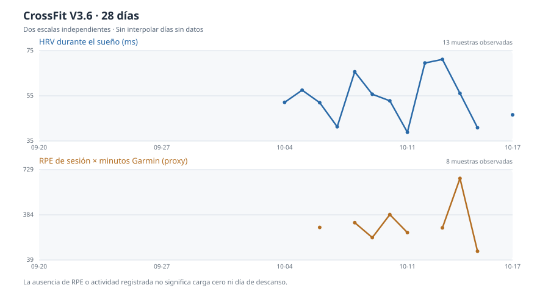

# Garmin Recovery · Informe CrossFit V3.6 · 2026-10-12

**Estado:** descriptive_limited · **Origen:** CrossFit y tendencias V3.2/V3.5 verificados.

## Entrenamiento (últimos 7 días)

- Sesiones registradas: **9**; RPE disponible: **9 de 9**.
- RPE medio por sesión: **6.39**.
- Duración registrada Garmin: **262.3 min**.
- Proxy sRPE × minutos Garmin: **1457.7** (no equivale al tiempo efectivo del WOD).
- Comparación semanal: **insuficiente historial comparable**.

## Recuperación y calidad

- Recuperación: **same_day_assessed**; puntuación heurística **88**, estado original **yellow**, confianza **medium**.
- HRV: **66 ms**; sueño: **7.23 h**; FC reposo: **53 lpm**.
- Calidad de datos Garmin: **74/100** (same_local_day; no es la nota del software).

## Evolución reciente

| Fecha | Sesiones | RPE medio | Proxy sRPE | HRV ms | Sueño h | FC reposo |
|---|---:|---:|---:|---:|---:|---:|
| 2026-10-06 | 2 | 6 | 288 | 51.94 | 5.52 | 58 |
| 2026-10-07 | 0 | — | — | 41.41 | 7.1 | 60 |
| 2026-10-08 | 3 | 5.33 | 324.7 | 65.46 | 7.72 | 53 |
| 2026-10-09 | 2 | 8.75 | 210.4 | 55.63 | 4.79 | 57 |
| 2026-10-10 | 1 | 6 | 386.2 | 52.75 | 8.93 | 57 |
| 2026-10-11 | 1 | 6 | 248.4 | 39 | 7.05 | 59 |
| 2026-10-12 | 0 | — | — | 66 | 7.23 | 53 |

*Una fecha con cero sesiones registradas no demuestra que fuera un día de descanso.*

## Fuerza: observaciones por equipo

| Ejercicio | Equipo | Unidad | Días distintos | Interpretación |
|---|---|---|---:|---|
| aperturas de pecho en máquina sentado | machine_stack | kg_indicado_maquina | 1 | insufficient_repeated_days |
| curl femoral de pie unilateral | machine_stack | kg_indicado_maquina | 1 | insufficient_repeated_days |
| curl femoral tumbado | machine_stack | kg_indicado_maquina | 1 | insufficient_repeated_days |
| peso muerto | barbell | kg_total_barra | 1 | insufficient_repeated_days |
| prensa horizontal | machine_stack | kg_indicado_maquina | 1 | insufficient_repeated_days |
| press banca en máquina sentado | machine_stack | kg_indicado_maquina | 1 | insufficient_repeated_days |
| press de pecho inclinado con mancuernas | dumbbell_pair | kg_total_dos_mancuernas | 1 | insufficient_repeated_days |
| press superinclinado iso lateral | plate_loaded_machine | kg_total_dos_lados | 1 | insufficient_repeated_days |
| sentadilla trasera | barbell | kg_total_barra | 2 | descriptive_only_not_rep_rpe_matched |
| tríceps en polea | machine_stack | kg_indicado_maquina | 1 | insufficient_repeated_days |

## Recomendaciones con evidencia

1. Registrar una segunda semana completa antes de interpretar cambios de carga 7d frente a 7d.
2. Registrar otra semana de sesiones comparables antes de valorar una tendencia semanal.
3. Comparar las series de cada ejercicio solo con la misma variante, equipamiento, repeticiones y esfuerzo; el peso pico aislado es descriptivo.

## Estado y limitaciones

- Certificado: **matched_data_ready_source**.
- Entrega en ChatGPT: **no verificada**.
- Frecuencia cardíaca y Body Battery: usar siempre la hora real de la muestra, no la hora de generación del JSON.
- El informe es descriptivo, no diagnóstico, y no demuestra causalidad.

